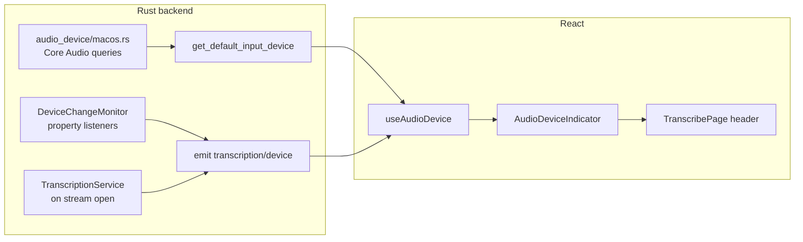

# Audio Device Indicator (macOS)

## Research: what macOS can detect

The app already captures audio via **cpal** using the OS default input/output devices ([`mic_input.rs`](tauri-app/src-tauri/src/transcription/mic_input.rs), [`system_audio.rs`](tauri-app/src-tauri/src/transcription/system_audio.rs)). cpal exposes **`device.name()`** only — no transport type, no jack state. To classify devices we need a small **macOS Core Audio** module alongside cpal.

### Reliably detectable (Core Audio APIs)

| Signal | API | What it tells us |
|--------|-----|------------------|
| Device name | `kAudioDevicePropertyDeviceNameCFString` | `"AirPods Pro"`, `"MacBook Pro Microphone"`, `"External Microphone"` |
| Transport | `kAudioDevicePropertyTransportType` | Built-in, Bluetooth, Bluetooth LE, USB, HDMI, Virtual/Aggregate, AirPlay |
| Wired 3.5mm jack (built-in output) | `kAudioDevicePropertyDataSource` on built-in output | `'hdpn'` = headphones plugged in, `'ispk'` = internal speakers |
| Default device changes | `kAudioHardwarePropertyDefaultInputDevice` / `DefaultOutputDevice` listeners | Hot-plug, AirPods connect/disconnect, jack insert/remove |
| Input vs output role | Query device with input/output scope + channel count | Mic vs speaker path |

**Transport types** (from `AudioHardwareBase.h`): `BuiltIn`, `Bluetooth`, `BluetoothLE`, `USB`, `HDMI`, `DisplayPort`, `Virtual`, `Aggregate`, `AirPlay`, etc.

### Not reliably detectable (important limitation)

macOS has **no form-factor property** (earbuds vs over-ear vs on-ear). AirPods Pro and Sony WH-1000XM5 both report `Bluetooth`/`BluetoothLE` transport. Distinguishing them requires **name heuristics**:

- **Earbuds**: `airpods` (not `max`), `buds`, `beats fit`, `beats studio buds`, `pixel buds`, etc.
- **Over-ear headphones**: `airpods max`, `wh-`, `qc`, `momentum`, `headphones`, `studio`, `bose 700`, etc.
- **Wired 3.5mm with mic**: often named `"External Microphone"` or `"External Headphones"` on built-in hardware; jack state via `hdpn` data source on built-in output
- **Wired 3.5mm listen-only** (no mic): output data source flips to `hdpn`, but **default mic may remain built-in** — UI should still show the mic device name honestly (e.g. "MacBook Pro Microphone") while optionally noting wired headphones on output in a later iteration

Bluetooth devices that are paired but powered off may still appear in system lists; we mitigate by querying the **default** device (what macOS is actually routing to) and listening for default-device change events.

### What we show (per your choices)

- **Always visible** on Transcribe page, **live-updating** on plug/unplug
- **Mic input device only** — even when source is `system` or `both`, show which **microphone** macOS would use (the default input). This answers "which mic is hearing me" without cluttering the header with loopback output info.

---

## Proposed device taxonomy and icons

Backend emits a stable `deviceKind` enum; frontend maps to inline SVGs (same Lucide-like style as [`MicIndicator.tsx`](tauri-app/src/components/MicIndicator.tsx) and [`sidebar-icons.tsx`](tauri-app/src/components/sidebar-icons.tsx)):

| `deviceKind` | When | Icon concept |
|--------------|------|--------------|
| `builtInMic` | Built-in transport, default input | Laptop / built-in mic |
| `wiredHeadset` | Built-in + data source `hdpn`, or name `External Microphone` / `Headphones` | Wired earbuds/headset |
| `bluetoothEarbuds` | BT/BLE + name heuristics (AirPods, buds, Fit, etc.) | Small earbuds |
| `bluetoothHeadphones` | BT/BLE + name heuristics (Max, WH-, QC, etc.) | Over-ear headphones |
| `bluetoothGeneric` | BT/BLE, no heuristic match | Generic Bluetooth + audio |
| `usbHeadset` | USB transport | USB headset/mic |
| `unknown` | Everything else | Generic mic (reuse current mic SVG) |

Classification logic lives in Rust (testable) with a small set of unit tests for name patterns.

---

## Architecture



### 1. Backend: macOS audio device module

Add [`tauri-app/src-tauri/src/audio_device/`](tauri-app/src-tauri/src/audio_device/) (gated with `#[cfg(target_os = "macos")]`):

- **`mod.rs`** — shared `AudioDeviceInfo` struct + `DeviceKind` enum, serde-serialized with camelCase
- **`macos.rs`** — Core Audio FFI (prefer `objc2-core-audio` to align with cpal 0.17's stack, or `coreaudio-rs` macos_helpers)
  - `get_default_input_device() -> AudioDeviceInfo`
  - `classify_device(name, transport, data_source) -> DeviceKind`
  - `spawn_device_monitor(app_handle)` — register `AudioObjectAddPropertyListenerBlock` on:
    - `kAudioHardwarePropertyDefaultInputDevice`
    - optionally built-in output `kAudioDevicePropertyDataSource` (to refine wired-headset detection when input is still built-in mic)

`AudioDeviceInfo` fields:

```rust
pub struct AudioDeviceInfo {
    pub name: String,
    pub kind: DeviceKind,
    pub transport: String,  // "builtIn" | "bluetooth" | "usb" | ...
}
```

### 2. Tauri IPC

- **New command** `get_default_input_device` in [`commands/`](tauri-app/src-tauri/src/commands/) — called on Transcribe page mount and after device-change events
- **New event** `transcription/device` (add to [`ipc/transcript.rs`](tauri-app/src-tauri/src/ipc/transcript.rs)) — payload: `{ device: AudioDeviceInfo }`
- Register command in [`lib.rs`](tauri-app/src-tauri/src/lib.rs)
- Start device monitor from `run()` on app startup (macOS only)
- Also emit `transcription/device` when mic stream opens in [`service.rs`](tauri-app/src-tauri/src/transcription/service.rs) (confirms device used during active session)

No change to capture pipeline — still uses cpal default input; this is **read-only metadata** for UX.

### 3. Frontend

| File | Change |
|------|--------|
| [`transcript-types.ts`](tauri-app/src/lib/transcript-types.ts) | Add `AudioDeviceInfo`, `DeviceKind` types |
| `hooks/useAudioDevice.ts` (new) | `invoke('get_default_input_device')` on mount; listen to `transcription/device` |
| `components/audio-device-icons.tsx` (new) | SVG icons per `DeviceKind` |
| `components/AudioDeviceIndicator.tsx` (new) | Icon + truncated device name chip |
| [`TranscribePage.tsx`](tauri-app/src/pages/TranscribePage.tsx) | Place indicator in `.header-controls` between Input select and `MicIndicator` |
| [`App.css`](tauri-app/src/App.css) | `.audio-device-indicator` styles (mirror `.source-select`, ellipsis for long names) |

**UX details:**
- Idle: muted text (`var(--text-secondary)`), full device name with tooltip `title` for truncation
- Active transcription: same indicator; optionally slightly brighter — device name already confirmed by backend emit on stream open
- `MicIndicator` stays as-is (RMS activity dot); device chip is separate

### 4. Tests

Rust unit tests for `classify_device`:
- `"AirPods Pro"` + bluetooth → `bluetoothEarbuds`
- `"AirPods Max"` + bluetooth → `bluetoothHeadphones`
- `"MacBook Pro Microphone"` + builtIn → `builtInMic`
- `"External Microphone"` + builtIn → `wiredHeadset`
- `"USB PnP Sound Device"` + usb → `usbHeadset`

No cpal/OS integration tests (already documented as manual in ARCHITECTURE.md).

---

## Out of scope (future)

- Device **picker** / manual selection (Settings page is a stub)
- Showing system **output** device for `system`/`both` modes (you chose mic-only)
- Hot-swap of cpal stream mid-session (ARCHITECTURE.md future work — indicator can update before user restarts)
- Windows/Linux ports

---

## Manual test plan

1. **Built-in mic** — no accessories: shows "MacBook … Microphone" + built-in icon
2. **Wired TRRS headset** — plug 3.5mm with mic: switches to "External Microphone" + wired icon
3. **Wired headphones only** — plug 3.5mm without mic: mic name may stay built-in (expected); verify label is accurate
4. **AirPods / earbuds** — connect BT: name + earbuds icon, live update on disconnect
5. **Over-ear BT headphones** — connect: name + over-ear icon
6. **USB headset** — connect: USB icon + device name
7. **During transcription** — start session, unplug/replug device: indicator updates; note capture may still use old device until stop/restart (document in UI tooltip if needed)
