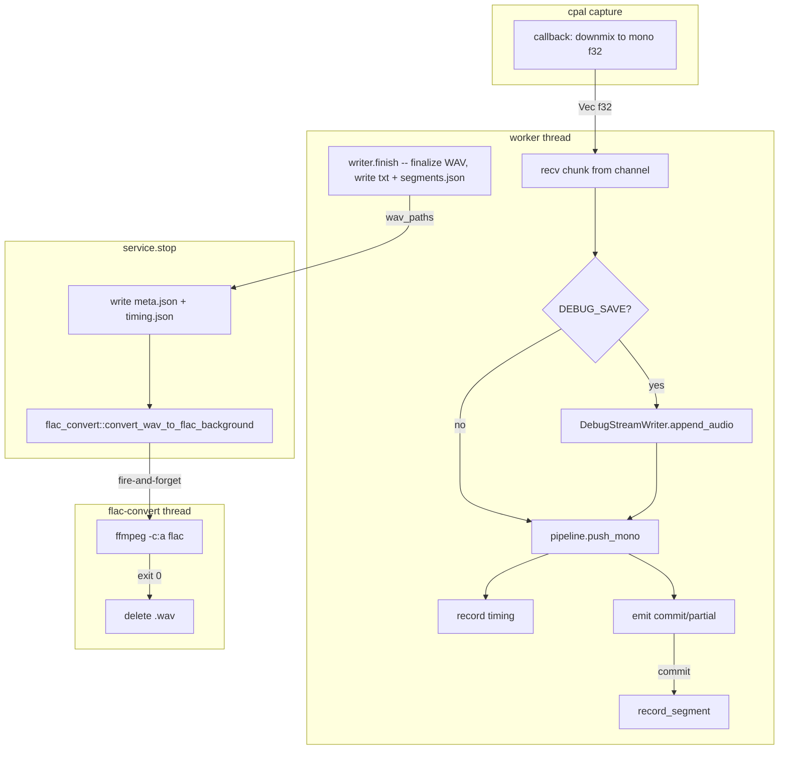

# Debug Session Dump

## Output Structure

When `DEBUG_SAVE=1` is set, each transcription session creates:

```
tauri-app/debug/
  2026-06-29T19-47-30/
    mic.flac                 # lossless compressed audio (converted from WAV on finalize)
    system.flac              # (only if source includes system audio)
    mic.txt                  # plain committed transcript text
    system.txt               # (only if source includes system audio)
    mic.segments.json        # array of TranscriptCommit events
    system.segments.json     # (only if source includes system audio)
    meta.json                # session metadata sidecar
    timing.json              # per-stream ASR timing stats
```

Audio files are streamed as WAV during capture, then converted to FLAC by a separate process on finalize. If ffmpeg is unavailable or conversion fails, the WAV is kept as fallback.

Single-stream sessions (source=`mic` or source=`system`) produce only the relevant stream files. `Both` produces both sets.

## New Module: `debug_dump`

Create [tauri-app/src-tauri/src/transcription/debug_dump.rs](tauri-app/src-tauri/src/transcription/debug_dump.rs) containing all debug-dump logic. Register it in [mod.rs](tauri-app/src-tauri/src/transcription/mod.rs).

### Key types

- **`DebugSession`** -- created at session start if `DEBUG_SAVE=1`. Holds the session dir path and timestamp. Created by `DebugSession::try_open()` which returns `Option<DebugSession>` (None when env var is unset).
- **`DebugStreamWriter`** -- per-stream handle. Each one owns:
  - A `BufWriter<File>` for incremental WAV writing (header written on creation, updated on drop/finalize with correct data length)
  - A `Vec<SegmentRecord>` accumulating commit events
  - A `Vec<TimingRecord>` accumulating ASR pass durations
  - Running `total_samples: u64` counter for WAV finalization

### WAV streaming strategy

WAV format is simple enough to write without a crate. Write a 44-byte header with placeholder data size on creation. On each `append_audio(&[f32])` call, convert to PCM16 LE and write to the `BufWriter`. On finalize (called from `Drop` or explicit `finish()`), seek back and patch the RIFF chunk size and data sub-chunk size. This avoids holding audio in memory.

After WAV finalization, `finish()` returns the WAV path. The caller (`service.rs`) collects all WAV paths and hands them to `flac_convert` for background conversion.

### Segment and timing records

```rust
#[derive(Serialize)]
struct SegmentRecord {
    segment_id: String,
    speaker: String,
    text: String,
    start_ms: u64,
    end_ms: u64,
}

#[derive(Serialize)]
struct TimingRecord {
    segment_id: String,
    push_mono_duration_ms: f64,
    chunk_samples: usize,
}
```

### `meta.json` contents

```rust
#[derive(Serialize)]
struct SessionMeta {
    session_id: String,           // the directory name (timestamp)
    started_at: String,           // ISO 8601
    stopped_at: String,           // ISO 8601 (written on finalize)
    source: String,               // "mic" | "system" | "both"
    model: String,                // WhisperKit model name
    streams: Vec<StreamMeta>,
}

#[derive(Serialize)]
struct StreamMeta {
    stream: String,               // "mic" | "system"
    device_name: String,
    sample_rate: u32,
    total_samples: u64,
    duration_secs: f64,
    captured_samples: u64,        // from cpal_capture stats
    dropped_samples: u64,
    dropped_frames: u64,
    commit_count: usize,
}
```

## New Module: `flac_convert`

Create [tauri-app/src-tauri/src/transcription/flac_convert.rs](tauri-app/src-tauri/src/transcription/flac_convert.rs) as an isolated module. Register it in [mod.rs](tauri-app/src-tauri/src/transcription/mod.rs).

This module runs ffmpeg as a **separate child process**, completely decoupled from the transcription pipeline. If ffmpeg crashes, panics, or is not installed, the main app is unaffected.

### Public API

```rust
/// Converts WAV files to FLAC in a background thread.
/// Deletes each WAV after successful conversion.
/// Returns immediately; conversion happens asynchronously.
pub fn convert_wav_to_flac_background(wav_paths: Vec<PathBuf>);

/// Synchronous single-file conversion (used by background thread, also testable).
/// Returns the FLAC path on success.
pub fn convert_wav_to_flac(wav_path: &Path) -> Result<PathBuf, FlacConvertError>;
```

### `convert_wav_to_flac` implementation

1. Derive FLAC path: replace `.wav` extension with `.flac`
2. Spawn `ffmpeg -i input.wav -c:a flac -y output.flac` as `std::process::Command`
3. Wait for exit, capture stderr
4. On exit code 0: delete the original WAV file (`std::fs::remove_file`), return `Ok(flac_path)`
5. On non-zero exit or spawn failure: return `Err(FlacConvertError)` with details, leave WAV intact

### `convert_wav_to_flac_background` implementation

Spawns a single `std::thread` named `"flac-convert"` that iterates over the WAV paths and calls `convert_wav_to_flac` for each. Logs results via `tracing::info!` / `tracing::warn!`. The thread is fire-and-forget (not joined by the caller).

### Error type

```rust
#[derive(Debug)]
pub enum FlacConvertError {
    FfmpegNotFound,
    FfmpegFailed { exit_code: Option<i32>, stderr: String },
    Io(std::io::Error),
}
```

## Integration Points

### 1. Session lifecycle in `service.rs`

In [service.rs](tauri-app/src-tauri/src/transcription/service.rs):

- **`start_internal()`**: After setting up `stop_flag` and `config`, call `DebugSession::try_open(source, &config)`. If `Some`, store it in `RunningState` (add `debug: Option<DebugSession>` field). Pass an `Option<DebugStreamWriter>` into each `spawn_stream_worker()` call.
- **`stop()`**: After joining workers, call `debug_session.finalize(capture_stats)` to write `meta.json` and `timing.json`. The `DebugStreamWriter`s will have already been finalized inside the worker threads (WAV headers patched, `.txt` and `.segments.json` written). `finalize()` returns the list of WAV paths, which are passed to `flac_convert::convert_wav_to_flac_background(wav_paths)` for async conversion. This fire-and-forget thread converts each WAV to FLAC and deletes the original.

### 2. Worker audio tee in `worker.rs`

In [worker.rs](tauri-app/src-tauri/src/transcription/worker.rs), `run_worker()` gains an `Option<DebugStreamWriter>` parameter:

- After receiving each chunk from `audio_rx`, if `debug_writer.is_some()`, call `writer.append_audio(&chunk)`.
- Wrap the `pipeline.push_mono(&chunk)` call with `Instant::now()` / `elapsed()` and, if writer is present, call `writer.record_timing(segment_id, elapsed, chunk.len())`.
- When a `Commit` event is emitted, call `writer.record_segment(...)`.
- At end of `run_worker()`, call `writer.finish()` to write the stream's `.txt` and `.segments.json` and finalize the WAV.

### 3. Device name propagation

Currently `cpal_capture.rs` logs the device name but doesn't return it. Change `OpenedCpalStream` (and `OpenedCapture` / `SystemAudioCapture`) to carry a `device_name: String` field so it can be passed through to the debug metadata.

### 4. Gitignore

Add `debug/` to [tauri-app/.gitignore](tauri-app/.gitignore).

### 5. Dependency: `hound` crate

Add `hound = "3"` to [Cargo.toml](tauri-app/src-tauri/Cargo.toml) for WAV writing. `hound::WavWriter` handles the header/finalization correctly and supports the streaming pattern with `finalize()`.

### 6. Runtime dependency: `ffmpeg`

ffmpeg must be installed on the dev machine for FLAC conversion. This is not a Cargo dependency -- it is invoked as a subprocess. The golden test infra already uses ffmpeg ([golden_diagnostic.rs](tauri-app/src-tauri/tests/golden_diagnostic.rs)), so it should already be present on dev machines. If missing, conversion is skipped with a warning and the WAV file is preserved.

## Data Flow (modified)



## What does NOT change

- The audio pipeline itself (cpal -> channel -> worker -> WhisperKit) is untouched. The debug dump is a pure side-effect tee.
- No new Tauri commands or UI changes.
- No impact when `DEBUG_SAVE` is unset -- the `Option` wrappers compile down to branch-never-taken.
- FLAC conversion runs in a detached thread after `stop()` returns. If ffmpeg crashes or is missing, the WAV files remain and the app continues normally.
