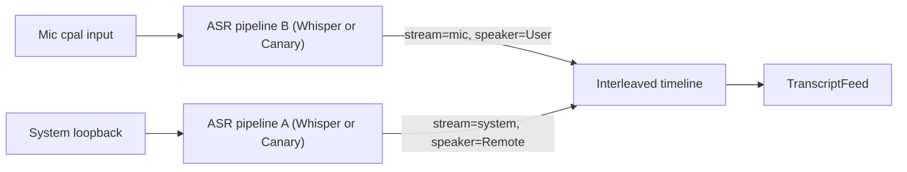
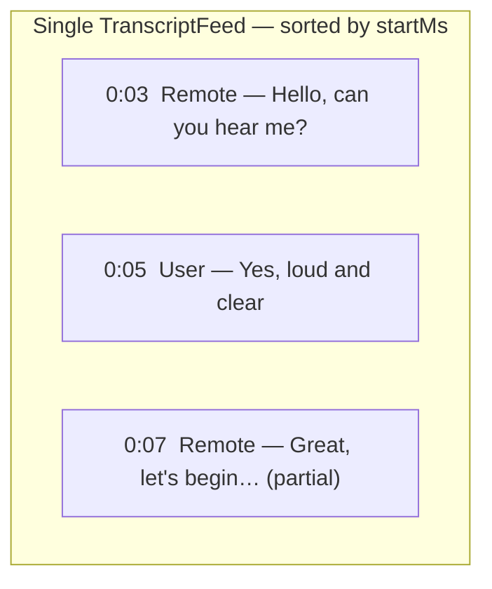

# Dual-Stream Mic + System Transcription

## Recommendation: Separate streams, not fusion

**Transcribe each audio input separately.** Do not mix mic and system into one mono bus before ASR.

| Approach                       | Quality | Why                                                                                                                                  |
| ------------------------------ | ------- | ------------------------------------------------------------------------------------------------------------------------------------ |
| **Separate ASR (recommended)** | Best    | Each stream has clean speaker attribution (`User` / `Remote`), independent VAD, no cross-talk confusion                              |
| **Fused mono mix**             | Poor    | Mic picks up speaker output (echo), overlapping speech becomes one muddy signal, Whisper hallucinates more, speaker identity is lost |

This is already the project's target design in [docs/technical/realtime-transcription.md](docs/technical/realtime-transcription.md) and [docs/technical/macos-capturing-audio.md](docs/technical/macos-capturing-audio.md):



**Why fusion fails in practice:**
- The mic naturally captures system audio from speakers → fused audio contains the remote voice twice (loopback + acoustic bleed).
- When both sides talk at once, a single Whisper pass cannot reliably separate speakers.
- VAD on mixed audio may gate out one speaker or treat silence incorrectly.
- Your IPC already carries `stream` + `speaker` per event — fusion would throw away that advantage.

**Compute cost:** Two pipelines from one loaded model is expected and budgeted. `LoadedEngine::create_pipeline()` takes `&self` and creates fully independent pipeline instances from the shared model state for both backends ([asr.rs](tauri-app/src-tauri/src/transcription/asr.rs)).

**Scope for v1:** Dual capture + dual ASR + static labels (`User` / `Remote`). Online diarization (`polyvoice`) on the remote stream is a later phase — not required to show both sources in the UX.

---

## Current state (gap)

- Backend: single `AudioSource` per session, one capture, one worker ([service.rs](tauri-app/src-tauri/src/transcription/service.rs))
- Frontend: exclusive mic/system `<select>`, single global `"tentative"` partial slot ([useTranscription.ts](tauri-app/src/hooks/useTranscription.ts))
- Events already include `stream` and `speaker` ([worker.rs](tauri-app/src-tauri/src/transcription/worker.rs)) but the UI ignores `stream`

---

## Backend changes

### 1. Extend source selection

Add `AudioSource::Both` (serde: `"both"`) in [audio_source.rs](tauri-app/src-tauri/src/transcription/audio_source.rs). `Both` is a session mode, not a third capture device — it opens mic + system concurrently.

Update `start_transcription` in [commands/transcription.rs](tauri-app/src-tauri/src/commands/transcription.rs) to accept `"both"`.

### 2. Dual capture in `TranscriptionService`

Refactor [service.rs](tauri-app/src-tauri/src/transcription/service.rs) `RunningState` to hold **two** optional capture/worker pairs:

```
RunningState {
  stop_flag,
  mic?: { capture, worker_handle, audio_tx },
  system?: { capture, worker_handle, audio_tx },
}
```

When `source == Both`:
- `capture::open_capture(Mic, mic_tx)` + `capture::open_capture(SystemAudio, sys_tx)`
- `engine.create_pipeline()` twice (independent `StreamingPipeline` instances)
- Spawn two `worker::run_worker` threads, each with its own `StreamLabels`

Shutdown order (already documented in ARCHITECTURE.md): drop both captures → close both senders → join both workers → emit `active: false`.

### 3. Fix per-stream partial IDs

In [worker.rs](tauri-app/src-tauri/src/transcription/worker.rs), change partial `segment_id` from hardcoded `"tentative"` to stream-scoped IDs, e.g. `"tentative-mic"` / `"tentative-system"` (derive from `labels.stream`). This lets the frontend maintain two live partials simultaneously.

### 4. Mic level events (minor)

Either:
- Tag `MicLevel` with `stream`, or
- Emit `transcription/mic_level` only from the mic worker (system level is less useful for the mic indicator)

Simplest v1: keep one level event from mic worker only; `MicIndicator` stays meaningful during dual mode.

### 5. Model constraints — both backends support dual mode

The new Canary CoreML implementation replaces the old Python sidecar entirely. It changes the picture compared to the original plan:

| Model | Dual pipeline support | Notes |
| --- | --- | --- |
| **Whisper small/large-v3-turbo** | Yes | Two independent `AsrPipeline` instances from one `OnlineAsrModel` |
| **Canary Qwen 2.5B (CoreML)** | Yes | `Arc<CanaryRuntime>` is shared; `CanaryEngine::from_runtime(runtime.clone())` creates fully independent engines cheaply |

`create_pipeline()` is `&self` (not `&mut self`), so calling it twice in a row for dual mode requires no locking change.

**Canary-specific UX note:** `CanaryEngine` produces **committed-only output** at 5-second chunk boundaries — no tentative words. During dual mode with Canary, both streams will have no live partials (the `"tentative-mic"` / `"tentative-system"` slots stay empty). The frontend handles this gracefully since empty tentative is already the initial state. No special casing needed.

### 6. Export / store

Update [transcript_store](tauri-app/src-tauri/src/transcription/transcript_store.rs) to prefix or section commits by stream when exporting, so "both" sessions produce readable output.

---

## UI: conversation timeline (critical)

**Goal:** One feed where line order matches **when things were said**, not which capture device produced the event first.

**Do not use two side-by-side columns** — that separates streams spatially and hides turn-taking. Use a **single chronological transcript**, like the web replay panel ([transcript-panel.tsx](web/src/components/session/transcript-panel.tsx)) which sorts by `atMs`.

### How timestamps work today

| Backend | `startMs` meaning | Timeline accuracy |
| --- | --- | --- |
| **Whisper** | Audio position within that stream's pipeline (seconds since stream started) | Good — word-level |
| **Canary** | Chunk index × 5s (`elapsed_seconds` per `CanaryEngine`) | Coarse — up to ~5s jitter vs mic |

Both workers reset to `t=0` when the session starts. That makes `startMs` **comparable across streams** as long as both captures open at the same moment (true for `Both` mode). ASR commit latency does **not** affect `startMs` — only audio position does.

**v1 limitation:** Canary dual-mode lines may appear slightly out of order relative to Whisper mic lines during fast back-and-forth (5s buckets). Whisper + Whisper is the high-fidelity timeline path.

### Recommended layout



Each line shows:
1. **Time label** — `formatTime(startMs)` e.g. `0:05` (session-relative, helps verify ordering)
2. **Speaker** — `User` (mic) or `Remote` (system); distinct colors per speaker
3. **Text** — committed or partial (italic + cursor for partial)

No separate "Mic" / "System" badge needed in v1 — speaker already maps 1:1 to stream (`User`↔mic, `Remote`↔system). Add a stream badge later when diarization introduces `Remote 1`, `Remote 2`.

### Timeline reducer (new logic in `useTranscription`)

Replace append-only array updates with a small `applyTranscriptEvent(prev, payload)` helper:

**Segment shape** ([transcript-types.ts](tauri-app/src/lib/transcript-types.ts)):

```ts
type TranscriptSegment = {
  id: string;
  speaker: string;
  stream: "mic" | "system";
  text: string;
  isPartial: boolean;
  startMs: number;
  endMs: number;   // NEW — from payload.endMs
};
```

**Sort key:** `(startMs, stream, id)` — stable tie-break when two lines share a start time.

**On partial** (`segmentId` = `tentative-mic` or `tentative-system`):
- Upsert the one partial slot for that stream (replace existing partial with same id)
- Re-run sort so the partial sits **inline** at its `startMs`, not at the bottom

**On commit:**
- Remove that stream's partial (`tentative-{stream}`)
- Insert committed segment
- **Coalesce** only when ALL of:
  - same `stream`
  - previous committed segment in sorted order is same `stream`
  - `prev.endMs + 1500 >= next.startMs` (1.5s gap — avoids merging across pauses)
- Then re-sort

**Do not** coalesce by "last array element" (current bug) — that breaks once we sort.

**Display order example:**

| Event order received | Sorted display |
| --- | --- |
| Remote commit 0:10 | Remote 0:10 |
| User partial 0:12 | Remote 0:10 → User 0:12 (partial) |
| User commit 0:12 | Remote 0:10 → User 0:12 |
| Remote partial 0:14 | Remote 0:10 → User 0:12 → Remote 0:14 (partial) |

### TranscriptFeed changes

In [TranscriptFeed.tsx](tauri-app/src/components/TranscriptFeed.tsx):

- Render segments **in array order** (already sorted by hook — feed does not re-sort)
- Add `timeLabel` column using `formatTime(segment.startMs)`
- CSS: `.transcript-line--user` / `.transcript-line--remote` for color (derive from `stream` or `speaker`)
- Partials stay inline at their timestamp position (not pinned to bottom)

Reference: web replay panel already shows `speaker` + `timeLabel` + partial styling — mirror that pattern.

### Source selector + footer

In [TranscribePage.tsx](tauri-app/src/pages/TranscribePage.tsx):

```tsx
<option value="both">Mic + system</option>
```

Footer for `both`: `"Capturing mic + system audio…"`

Extend `AudioSource` to `"mic" | "system" | "both"`.

---

## Backend: shared session clock (for timeline fidelity)

Lightweight addition in [service.rs](tauri-app/src-tauri/src/transcription/service.rs) when starting `Both`:

1. Record `session_start = Instant::now()` (or pass `Arc<AtomicU64>` sample counters)
2. Each worker tracks **samples received** and can optionally normalize timestamps: `start_ms = samples_seen / sample_rate * 1000`

For Whisper, ASR-reported word times should already match audio position — sample counter is a fallback / validation. For Canary, chunk timestamps already track audio elapsed.

**Optional v1.1:** lightweight `merge` module (per [realtime-transcription.md](docs/technical/realtime-transcription.md)) that owns one sorted timeline and emits events in order — removes sort burden from frontend. Not required for v1 if frontend reducer is correct.

---

## Testing

| Layer | Test |
| --- | --- |
| `audio_source.rs` | Parse `"both"`, labels unchanged per stream |
| `service.rs` | `Both` spawns two workers; double-start still guarded |
| `worker.rs` | Partial segment IDs are stream-scoped (`tentative-mic`, `tentative-system`) |
| `timeline reducer` | Interleave out-of-order commits by `startMs`; inline partials; coalesce only same-stream adjacent |
| `TranscriptFeed` | Renders sorted segments with time labels |
| Manual | VoIP call: verify Remote speaks → User replies → lines appear in spoken order, not arrival order |

**Manual timeline check:** Play a call where remote speaks at 0:03 and user replies at 0:06. Remote line must appear above User line even if User commit arrives first (simulate by blocking one worker briefly).

---

## Future enhancements (out of scope for v1)

- **Backend merge module:** single timeline owner in Rust emits pre-sorted events (matches long-term architecture doc)
- **Clock drift correction:** if mic/system clocks diverge over long calls, apply per-stream offset calibration
- **Echo cancellation (VPIO):** reduces duplicate remote speech on mic track ([macos-capturing-audio.md](docs/technical/macos-capturing-audio.md))
- **Diarization on remote stream:** `polyvoice` for `Remote 1`, `Remote 2` per [realtime-transcription.md](docs/technical/realtime-transcription.md)
- **ScreenCaptureKit per-app capture:** replace cpal loopback for cleaner remote track

---

## Implementation order

1. Backend: `AudioSource::Both` + dual capture/workers + stream-scoped partial IDs + session clock anchor
2. Frontend: timeline reducer (`applyTranscriptEvent`) + extended segment type with `endMs`/`stream`
3. UI: single sorted `TranscriptFeed` with time labels + speaker styling + "Mic + system" option
4. Tests: reducer unit tests + manual VoIP timeline validation
