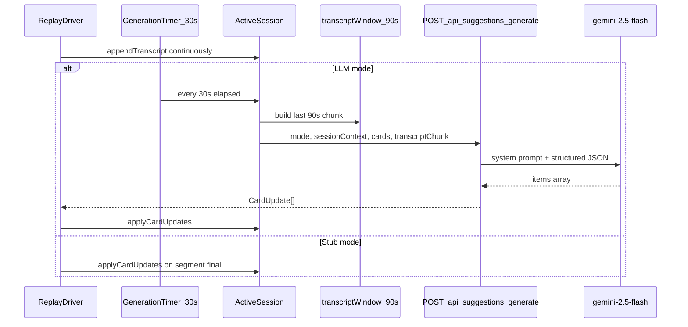

# LLM Suggestions API (Gemini 2.5 Flash)

## Goal

Replace stub-only card generation with a real LLM path for testing. The client chunks transcript to a **90-second sliding window**, sends session state to a new API route, and appends any returned card items. A **Stub | LLM toggle** in replay controls lets you compare against [`customer-interview-meeting-copilot.stub-updates.json`](tests/transcripts/customer-interview-meeting-copilot.stub-updates.json).

## Architecture



## Generation cadence: 30s trigger, 90s window

| Parameter         | Value                                                                 |
| ----------------- | --------------------------------------------------------------------- |
| Transcript window | Last **90 seconds** of finalized speech at call time                  |
| Trigger interval  | Every **30 seconds** of session elapsed time (virtual time in replay) |
| Window overlap    | ~60s of transcript is shared between consecutive calls                |

### Risks and mitigations

| Risk                                   | Severity   | Why it happens                                                                                                         | Mitigation in v1                                                                                                                        |
| -------------------------------------- | ---------- | ---------------------------------------------------------------------------------------------------------------------- | --------------------------------------------------------------------------------------------------------------------------------------- |
| **Suggestion churn / near-duplicates** | High       | 60s overlap means the model re-reads the same dialogue 2–3 times; Morgan explicitly called this a turn-off (`seg-020`) | Strong prompt: prefer `[]`; pass all existing items with disposition; server-side normalized-text dedupe; cap 2 items per card per call |
| **Discarded items resurfacing**        | Medium     | Same overlapping text re-exposed every 30s                                                                             | Prompt rule + server filter: block items matching discarded text unless rationale cites *new* lines from the chunk                      |
| **Calls during silence**               | Medium     | Timer fires even when no new speech landed                                                                             | Skip call if no new finalized transcript since last generation (hash or `lastGeneratedAtMs` watermark)                                  |
| **Weak-signal hallucinations**         | Medium     | Model pressured to produce output on a schedule                                                                        | Prompt: empty list is correct; skip call if window has fewer than ~20 words of new content since last call                              |
| **Rhythm mismatch**                    | Low–Medium | Stubs fire on customer answer boundaries (~52s avg); fixed 30s may hit mid-exchange                                    | Acceptable for v1 testing; optional later: also trigger on segment finalization                                                         |
| **In-flight overlap**                  | Medium     | Gemini latency can exceed 30s                                                                                          | One in-flight request max; monotonic sequence number; discard stale responses                                                           |
| **Cost / rate limits**                 | Low        | ~2 calls/min → ~26 calls per 13-min fixture                                                                            | Gemini 2.5 Flash is cheap; acceptable for dev/testing                                                                                   |
| **Burst UI updates**                   | Low        | Responses arrive in clumps if API is slow                                                                              | Append-only; cards already handle smooth scroll                                                                                         |

**Verdict:** 30s / 90s is workable for testing if generation is **not blind** — skip when transcript is unchanged, enforce dedupe server-side, and treat empty responses as success. The main product risk is churn, not cost or latency.

## 1. Dependencies and env

- Add [`@google/genai`](https://www.npmjs.com/package/@google/genai) to [`web/package.json`](web/package.json)
- Model: **`gemini-2.5-flash`** with `thinkingBudget: 0` for low-latency live suggestions
- New [`web/.env.example`](web/.env.example):
  - `GEMINI_API_KEY=` (required for LLM mode)
- API route reads `process.env.GEMINI_API_KEY`; returns `503` if missing

## 2. Types and contracts

Extend [`web/src/lib/session/types.ts`](web/src/lib/session/types.ts):

```typescript
export type SessionContext = {
  goal?: string;
  participantSegment?: string;
  hypothesis?: string;
  additionalContext?: string;
};

export type SuggestionItemState = {
  id: string;
  text: string;
  rationale: string;
  disposition: ItemDisposition;
};

export type GenerateSuggestionsRequest = {
  mode: SessionMode;
  sessionContext?: SessionContext;
  cards: Array<{
    id: string;
    title: string;
    items: SuggestionItemState[];
  }>;
  transcriptChunk: Array<{ speaker: string; text: string; atMs: number }>;
};

export type GeneratedSuggestion = {
  cardId: string;
  text: string;
  rationale: string;
};

export type GenerateSuggestionsResponse = {
  items: GeneratedSuggestion[];
};
```

**v1 scope:** API returns **append-only** new items (no `revise` ops). Empty `items: []` when nothing meaningful to add.

## 3. 90-second transcript window (client)

New [`web/src/lib/llm/transcript-window.ts`](web/src/lib/llm/transcript-window.ts):

- Export `TRANSCRIPT_WINDOW_MS = 90_000`
- `buildTranscriptWindow(lines, atMs)` — returns finalized lines where `atMs >= (elapsedMs - 90_000)` and `!isPartial`
- Format as structured array for the API (speaker + text + atMs)

Update [`web/src/lib/session/active-session.ts`](web/src/lib/session/active-session.ts):

- Change `RECENT_TRANSCRIPT_MS` from `180_000` → `90_000`
- Add optional `sessionContext` to `CreateSessionInput` and store on session
- Add `buildGenerateRequest(): GenerateSuggestionsRequest` that:
  - Uses `buildTranscriptWindow` on current transcript
  - Groups **all** items per card (active, pinned, done, discarded) with disposition — replaces the split `activeItems` / `suppressedTopics` shape for API calls
  - Keeps existing `getGenerationContext()` working or delegates to the new builder

## 4. Prompt design

New [`web/src/lib/llm/prompt.ts`](web/src/lib/llm/prompt.ts) — builds system + user messages.

**System prompt** (key rules from [`docs/features/live-suggestion-cards.md`](docs/features/live-suggestion-cards.md)):

- Role: live conversation copilot for `{mode}` — not a chat assistant
- Four card purposes with definitions (`follow-ups`, `needs`, `risks`, `topics`)
- **Append only** when idea is genuinely new; prefer silence over noise
- **Dedupe** semantically against all existing items (active, pinned, done) — no near-duplicates
- **Discarded items**: never resurface unless transcript chunk contains **substantial new evidence** (new facts, quotes, or escalation — not a passing mention)
- Item text: short, actionable (one line). Rationale: 1–2 sentences citing recent transcript
- Output: JSON only, matching response schema

**User prompt** sections:

1. **Session context** — goal, segment, hypothesis, additional context (from fixture `meta.product_context` + optional fields)
2. **Existing items by card** — grouped by `cardId`, each item with `id`, `text`, `rationale`, `disposition` (discarded items clearly marked)
3. **Transcript chunk (last 90 seconds)** — speaker-labeled lines

**Response schema** (Gemini structured output):

```json
{
  "items": [
    { "cardId": "follow-ups", "text": "...", "rationale": "..." }
  ]
}
```

## 5. Gemini client and response validation

New files under `web/src/lib/llm/`:

- [`gemini.ts`](web/src/lib/llm/gemini.ts) — `generateSuggestions(request)` using `@google/genai` with `responseMimeType: "application/json"` and a JSON schema
- [`validate-response.ts`](web/src/lib/llm/validate-response.ts) — parse JSON, validate `cardId` against mode cards, strip empty text, cap items per call (e.g. max 6 total) as a safety net

Server-side post-filter (belt-and-suspenders):

- Drop items whose `cardId` is unknown for the mode
- Optionally drop items that are exact/near-exact matches of discarded item text (simple normalized string compare; semantic dedupe is primarily prompt-driven)

## 6. API route

New [`web/src/app/api/suggestions/generate/route.ts`](web/src/app/api/suggestions/generate/route.ts):

```
POST /api/suggestions/generate
```

- Validate request body (mode, cards, transcriptChunk required)
- Call `generateSuggestions()`
- Return `{ items: [...] }` or `{ items: [] }`
- Error handling: `400` bad input, `503` missing key, `502` Gemini failure (with safe error message, no key leakage)

## 7. Client fetch wrapper

New [`web/src/lib/llm/generate-suggestions-client.ts`](web/src/lib/llm/generate-suggestions-client.ts):

- `fetchGenerateSuggestions(request): Promise<GeneratedSuggestion[]>`
- Maps response to `CardUpdate[]` via `{ cardId, ops: [{ kind: "append", text, rationale }] }`

## 8. Replay driver integration

Update [`web/src/lib/replay/replay-driver.ts`](web/src/lib/replay/replay-driver.ts):

- Add `generationMode: "stub" | "llm"` to `ReplayDriverInput`
- Export `GENERATION_INTERVAL_MS = 30_000` alongside `TRANSCRIPT_WINDOW_MS = 90_000`
- **stub mode**: unchanged — `fireStubUpdates(segmentId)` on segment final
- **llm mode**: separate generation timer driven by session `elapsedMs`:
  - On each play tick, if `elapsedMs - lastGenerationMs >= 30_000`, attempt a generation
  - Build request from `session.buildGenerateRequest()` (90s window baked in)
  - **Skip guards** (avoid blind 30s polling):
    - No finalized lines in the 90s window
    - No new finalized transcript since `lastGenerationMs` (watermark on latest line `atMs`)
    - Fewer than ~20 words added since last call (optional secondary guard)
  - **Concurrency**: one in-flight request; increment `generationSeq`; ignore responses where `seq < latestSeq`
  - On success: `session.applyCardUpdates(updates)`; set `lastGenerationMs = elapsedMs`
  - Timer pauses when replay is paused; resets on session reset

## 9. UI: Stub | LLM toggle

Update [`web/src/components/session/replay-controls.tsx`](web/src/components/session/replay-controls.tsx):

- `ToggleGroup`: **Stub** | **LLM**
- Pass `generationMode` into `createReplayDriver`

Update [`web/src/components/session/session-page.tsx`](web/src/components/session/session-page.tsx):

- State: `generationMode` (default `"stub"`)
- Pass fixture context into session:

```typescript
createActiveSession({
  mode: "customer_interview",
  title: fixture.meta.title,
  speakers: fixture.speakers,
  sessionContext: {
    additionalContext: fixture.meta.product_context,
    goal: "Evaluate meeting copilot for UX research interviews",
    participantSegment: "Head of UX Research at B2B SaaS",
    hypothesis: "Stable card grid with low-noise follow-ups beats chat-style AI",
  },
});
```

Optional lightweight indicator: small "Generating…" dot when LLM request is in-flight (via driver subscribe callback).

## 10. Testing approach

Manual test plan (no automated LLM tests in v1):

1. Set `GEMINI_API_KEY` in `web/.env.local`, run `npm run dev`
2. Load default fixture, switch to **LLM**, play through `seg-006` / `seg-010` / `seg-014`
3. Verify cards receive grounded items with rationales; compare qualitatively to stub file
4. Discard an item, continue playback — item should not reappear unless transcript adds new evidence
5. Switch back to **Stub** — deterministic replay still works

## Files changed (summary)

| Action | File                                             |
| ------ | ------------------------------------------------ |
| Create | `web/src/lib/llm/transcript-window.ts`           |
| Create | `web/src/lib/llm/prompt.ts`                      |
| Create | `web/src/lib/llm/gemini.ts`                      |
| Create | `web/src/lib/llm/validate-response.ts`           |
| Create | `web/src/lib/llm/generate-suggestions-client.ts` |
| Create | `web/src/app/api/suggestions/generate/route.ts`  |
| Create | `web/.env.example`                               |
| Modify | `web/package.json`                               |
| Modify | `web/src/lib/session/types.ts`                   |
| Modify | `web/src/lib/session/active-session.ts`          |
| Modify | `web/src/lib/replay/replay-driver.ts`            |
| Modify | `web/src/components/session/replay-controls.tsx` |
| Modify | `web/src/components/session/session-page.tsx`    |

## Out of scope (v1)

- `revise` ops from LLM
- Session context editor UI (hardcoded from fixture for now)
- Automated eval against stub-updates.json
- Rate limiting / caching beyond in-flight dedupe
