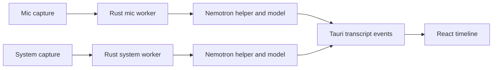

# Replace WhisperKit with Nemotron

## Architecture decisions
- Pin `speech-swift` **0.0.22** and import `NemotronStreamingASR`; explicitly load `aufklarer/Nemotron-Speech-Streaming-0.6B-CoreML-INT8`. Do not use bare `fromPretrained()`, which now defaults to the multilingual model.
- Provision the model into the app-controlled cache and load it with `fromLocal(bundleDir:)`. The bundle is fixed at **160 ms**, 16 kHz mono Float32.
- Run one `nemotron-bridge` process/model per active stream (mic and system). This follows speech-swift’s documented non-thread-safe constraint and retains process isolation; dual-stream mode therefore loads two model instances.
- Keep existing `transcript/partial` and `transcript/commit` frontend events, but remove every Whisper model/configuration path and compatibility alias.

## 1. Replace the Swift helper and model provisioning
- Delete [`tauri-app/whisperkit-helper`](/Users/pavel/Projects/realtime-transcription/tauri-app/whisperkit-helper) and create `tauri-app/nemotron-helper` with a release executable named `nemotron-bridge`.
- In the new `Package.swift`, pin `https://github.com/soniqo/speech-swift.git` at `0.0.22`, target macOS 15, and depend on the `NemotronStreamingASR` product.
- Implement model loading with `NemotronStreamingASRModel.fromLocal(bundleDir:)`; validate `encoder.mlmodelc`, `decoder.mlmodelc`, `joint.mlmodelc`, `config.json`, and `vocab.json` before reporting ready.
- Replace [`tauri-app/scripts/setup-whisperkit.sh`](/Users/pavel/Projects/realtime-transcription/tauri-app/scripts/setup-whisperkit.sh) with `setup-nemotron.sh` that downloads the explicitly pinned English artifact into `~/Library/Application Support/com.pavel.tauri-app/models/nemotron`, builds the helper, and performs a load smoke test.
- Add the NVIDIA model license and required `NOTICE` to redistribution/packaging assets; speech-swift remains Apache-2.0.

## 2. Implement true streaming and utterance commits
- Replace Whisper’s window re-decoding in [`main.swift`](/Users/pavel/Projects/realtime-transcription/tauri-app/whisperkit-helper/Sources/WhisperkitBridge/main.swift) with a Nemotron session using `createSession()`, `pushAudio(_:)`, and terminal `finalize()`.
- Treat each `pushAudio` result as a **cumulative hypothesis**, replacing the current partial instead of appending it. Ignore `segmentIndex` and confidence for commit decisions because the SDK does not currently provide useful segmentation or calibrated confidence.
- Preserve the engine-neutral PCM16 decoding, 16 kHz resampling, sample clock, and silence detection concepts, but remove Whisper segment adapters, 10/30-second windows, forced chunk sizing, hallucination filters, tokenizer handling, and Whisper decode options.
- Use rolling energy-based end-of-utterance detection: after configurable trailing silence, call `finalize()`, emit one committed utterance, then create a fresh Nemotron session. Emit sample-clock segment bounds because speech-swift exposes no timestamps or alignments. Start with the existing RMS threshold and test a shorter silence duration separately rather than hard-coding an unvalidated value.
- Wrap inference in `autoreleasepool`; add controlled helper/model recycling between completed app sessions to mitigate documented long-running CoreML IOSurface exhaustion.

## 3. Replace the Rust ASR adapter without frontend compatibility code
- Replace [`transcription/whisperkit.rs`](/Users/pavel/Projects/realtime-transcription/tauri-app/src-tauri/src/transcription/whisperkit.rs) with `transcription/nemotron.rs`, using a simplified JSON-lines protocol: `init`, `audio`, `finish`, `shutdown` and `ready`, `loading`, `partial`, `commit`, `error`, `finished`.
- Remove Whisper-only fields (`language`, model selector, tokenizer metadata, `disablePartials`) and use the English Nemotron model identity everywhere.
- Update [`transcription/asr.rs`](/Users/pavel/Projects/realtime-transcription/tauri-app/src-tauri/src/transcription/asr.rs), [`transcription/pipeline.rs`](/Users/pavel/Projects/realtime-transcription/tauri-app/src-tauri/src/transcription/pipeline.rs), and [`config.rs`](/Users/pavel/Projects/realtime-transcription/tauri-app/src-tauri/src/config.rs) to use `NEMOTRON_BRIDGE_PATH`, the Nemotron cache, artifact validation, and the new helper type. Remove `LoadedModels` and other backwards-compatible Whisper aliases.
- Keep [`transcription/worker.rs`](/Users/pavel/Projects/realtime-transcription/tauri-app/src-tauri/src/transcription/worker.rs), capture modules, transcript IPC, and React timeline behavior structurally unchanged; adjust naming and tests where they assume Whisper output granularity.
- Update sidecar packaging in `tauri.conf.json` and build scripts so release builds locate `nemotron-bridge` without source-tree paths.

## 4. Rework evaluation around fixed ground truth
- Update [`scripts/run-golden-test.sh`](/Users/pavel/Projects/realtime-transcription/tauri-app/scripts/run-golden-test.sh), [`golden_diagnostic.rs`](/Users/pavel/Projects/realtime-transcription/tauri-app/src-tauri/tests/golden_diagnostic.rs), and [`golden_transcript.rs`](/Users/pavel/Projects/realtime-transcription/tauri-app/src-tauri/tests/golden_transcript.rs) for the new helper/cache and continuous partial cadence.
- Do **not** regenerate reference transcripts from Nemotron. Audit the existing references against the source audio and correct them manually where needed so the candidate model cannot grade itself.
- Measure file WER, loopback E2E WER, first-partial p50/p95, finalization delay after speech, helper RSS for one/two streams, dropped/backlogged audio, timestamp drift, and repeated start/stop behavior.
- Keep the existing 5% WER gate until measurements justify an explicit product decision; do not silently raise it to accommodate the published 7–8% external average.
- Run a 30-minute simultaneous mic/system soak test and repeated session lifecycle test, specifically watching CoreML/IOSurface stability.

## 5. Remove Whisper documentation and finish the migration
- Delete Whisper setup/runtime references and update [`README.md`](/Users/pavel/Projects/realtime-transcription/tauri-app/README.md), [`MODEL_INVESTIGATION.md`](/Users/pavel/Projects/realtime-transcription/MODEL_INVESTIGATION.md), [`docs/technical/realtime-transcription.md`](/Users/pavel/Projects/realtime-transcription/docs/technical/realtime-transcription.md), and golden-dataset documentation to describe the actual Nemotron process-per-stream architecture.
- Remove all `WHISPERKIT_*`, Whisper model names, Argmax dependencies, cache paths, scripts, and stale yamabiko/whisper.cpp claims found by repository search.
- Verify with `swift test`, release helper build/load smoke test, `cargo test`, frontend tests, file diagnostic, headless golden E2E, manual dual-stream transcription, and the soak test.
