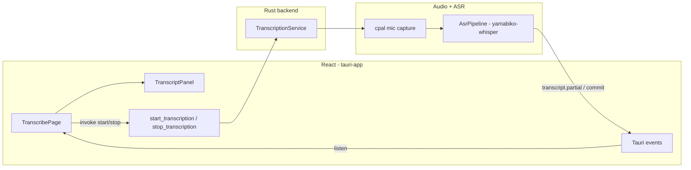

# Live Transcription Page (Mic + User Label)

## Scope

- **In scope:** New page in [`tauri-app`](tauri-app/) with Start/Stop, mic capture, streaming transcription, scrollable auto-scrolling transcript, speaker label **`User`** on every line.
- **Out of scope (deferred):** ScreenCaptureKit / remote (2nd) stream — but event payloads and UI will use a `speaker` field so `Remote` (or similar) can be added in phase 3 per [`docs/technical/realtime-transcription.md`](docs/technical/realtime-transcription.md).
- **Stack:** Aligns with [`docs/technical/macos-app-architecture.md`](docs/technical/macos-app-architecture.md) and phase 1–2 of the transcription doc (`yamabiko-whisper` + Tauri events + React).

## Architecture



## 1. Rust backend — transcription service

Add a small module tree under [`tauri-app/src-tauri/src/`](tauri-app/src-tauri/src/):

| Module                     | Responsibility                                                |
| -------------------------- | ------------------------------------------------------------- |
| `transcription/mod.rs`     | `TranscriptionService` state, start/stop lifecycle            |
| `transcription/capture.rs` | `cpal` default input device → `f32` PCM chunks                |
| `transcription/asr.rs`     | Load models, build `AsrPipeline` (VAD-backed), process chunks |
| `transcription/events.rs`  | Serialize + emit Tauri events                                 |

**Dependencies** — extend [`tauri-app/src-tauri/Cargo.toml`](tauri-app/src-tauri/Cargo.toml):

```toml
yamabiko-whisper = { version = "0.2", features = ["metal"] }
cpal = "0.15"
tokio = { version = "1", features = ["sync"] }
anyhow = "1"
```

**Model files** (dev setup, not bundled in v1):
- Whisper: `ggml-small.en.bin` or `ggml-large-v3-turbo` (per doc; start with `small.en` for faster iteration)
- Silero VAD: `ggml-silero-*.bin` (required by yamabiko-whisper 0.2+)
- Resolve path via env var `WHISPER_MODEL_PATH` / `VAD_MODEL_PATH`, or `~/Library/Application Support/com.pavel.tauri-app/models/`

**Threading model:**
- Tauri command `start_transcription` spawns a dedicated thread (or `tokio::task::spawn_blocking`) owning mic + pipeline — inference must not block the main thread.
- Use `std::sync::atomic` + `Arc<AtomicBool>` (or channel) for cooperative stop when `stop_transcription` is called.
- Store `TranscriptionService` in Tauri managed state (`app.manage(...)`).

**Speaker labeling (mic-only):**
- Hard-code `speaker: "User"` and `stream: "mic"` on every emitted segment (matches future `Me` → `User` product naming).

## 2. Tauri IPC contract

Mirror the event shape from [`docs/technical/realtime-transcription.md`](docs/technical/realtime-transcription.md) (subset for mic-only):

**Commands** ([`lib.rs`](tauri-app/src-tauri/src/lib.rs)):

```rust
#[tauri::command]
async fn start_transcription(state: State<'_, TranscriptionHandle>) -> Result<(), String>

#[tauri::command]
async fn stop_transcription(state: State<'_, TranscriptionHandle>) -> Result<(), String>
```

**Events** (Rust → React):

| Event                  | Payload                                                               |
| ---------------------- | --------------------------------------------------------------------- |
| `transcript.partial`   | `{ speaker: "User", stream: "mic", text, startMs, endMs, segmentId }` |
| `transcript.commit`    | `{ speaker: "User", stream: "mic", text, startMs, endMs, segmentId }` |
| `transcription.status` | `{ active: bool, model?: string, error?: string }`                    |

- **Partial vs commit:** Map yamabiko-whisper tentative hypothesis → `transcript.partial`; committed words → `transcript.commit` (aperçu pattern from doc).
- On stop: emit `transcription.status { active: false }` and flush any final commit.

**Capabilities** — no new Tauri permissions needed beyond `core:default` for commands/events.

## 3. macOS permissions

Add to [`tauri-app/src-tauri/tauri.conf.json`](tauri-app/src-tauri/tauri.conf.json) (or `Info.plist` merge):

```json
"macOS": {
  "infoPlist": {
    "NSMicrophoneUsageDescription": "This app needs microphone access for live transcription."
  }
}
```

Handle permission denial: if `cpal` fails to open the device, emit `transcription.status` with an error string the UI can display.

## 4. React UI — TranscribePage

Replace the scaffold [`tauri-app/src/App.tsx`](tauri-app/src/App.tsx) with a dedicated page (no router needed yet).

**New files:**

- `src/pages/TranscribePage.tsx` — layout, Start/Stop button, status line
- `src/components/TranscriptFeed.tsx` — scrollable transcript list
- `src/hooks/useTranscription.ts` — `invoke` + `listen` wiring, local state
- `src/lib/transcript-types.ts` — `TranscriptSegment` type matching IPC payloads

**UI behaviour:**

| Element         | Behaviour                                                                                                                                                                           |
| --------------- | ----------------------------------------------------------------------------------------------------------------------------------------------------------------------------------- |
| Start button    | Calls `start_transcription`; disabled while active                                                                                                                                  |
| Stop button     | Calls `stop_transcription`; disabled when idle                                                                                                                                      |
| Transcript feed | `overflow-y: auto`, `flex: 1`, `min-height: 0`                                                                                                                                      |
| Auto-scroll     | `useEffect` on segment list — set `scrollTop = scrollHeight` (same pattern as [`web/src/components/session/transcript-panel.tsx`](web/src/components/session/transcript-panel.tsx)) |
| Line rendering  | Speaker label **`User`** in bold, partial text muted + optional cursor, committed text normal                                                                                       |
| Partial updates | Key by `segmentId`; replace in place when commit arrives for same id                                                                                                                |

**State model** (`useTranscription`):

```typescript
type TranscriptSegment = {
  id: string;
  speaker: "User"; // extend to "Remote" later
  text: string;
  isPartial: boolean;
  startMs: number;
};
```

Append new commits; update existing entry when partial→commit for same `segmentId`.

**Styling:** Minimal CSS in [`App.css`](tauri-app/src/App.css) — full-height column layout (`html, body, #root, main { height: 100% }`), transcript area grows to fill remaining space.

## 5. Developer setup & verification

**One-time model download** (document in [`tauri-app/README.md`](tauri-app/README.md)):

```bash
mkdir -p ~/Library/Application\ Support/com.pavel.tauri-app/models
# Download ggml-small.en.bin + silero VAD from Hugging Face / whisper.cpp releases
export WHISPER_MODEL_PATH=...
export VAD_MODEL_PATH=...
```

**Manual test plan:**
1. `pnpm tauri dev` from `tauri-app/`
2. Grant microphone permission when prompted
3. Click **Start** → speak → see partial (gray) then committed (solid) lines labeled **User**
4. Transcript panel scrolls to bottom as new text arrives
5. Click **Stop** → capture ends, no new segments
6. Restart app → Start again works (no leaked mic handle)

## 6. Future hook points (not built now)

- Add `stream: "remote"` + speaker `Remote 1` when SCK capture lands (phase 3)
- Merge timeline in Rust before emitting (single ordered feed)
- Reuse segment types in the main session UI / LLM pipeline from [`web/src/lib/session/types.ts`](web/src/lib/session/types.ts) `TranscriptIngress`

## File change summary

| File                                | Change                                           |
| ----------------------------------- | ------------------------------------------------ |
| `src-tauri/Cargo.toml`              | Add whisper/cpal/tokio deps                      |
| `src-tauri/src/lib.rs`              | Register commands, managed state, module exports |
| `src-tauri/src/transcription/*`     | New — capture, ASR, events                       |
| `src-tauri/tauri.conf.json`         | Mic usage description                            |
| `src/App.tsx`                       | Render `TranscribePage`                          |
| `src/pages/TranscribePage.tsx`      | New                                              |
| `src/components/TranscriptFeed.tsx` | New                                              |
| `src/hooks/useTranscription.ts`     | New                                              |
| `src/lib/transcript-types.ts`       | New                                              |
| `src/App.css`                       | Full-height layout                               |
| `README.md`                         | Model download + run instructions                |
