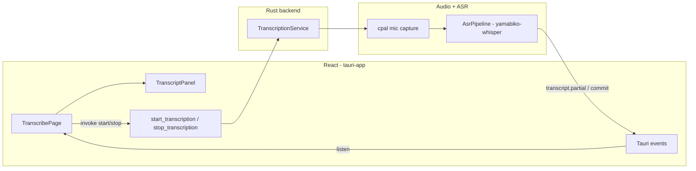

# Live Transcription Page (Mic + User Label)

## Scope

- **In scope:** New page in [`tauri-app`](tauri-app/) with Start/Stop, mic capture, streaming transcription, scrollable auto-scrolling transcript, speaker label **`User`** on every line.
- **Out of scope (deferred):** ScreenCaptureKit / remote (2nd) stream — but event payloads and UI will use a `speaker` field so `Remote` (or similar) can be added in phase 3 per [`docs/technical/realtime-transcription.md`](docs/technical/realtime-transcription.md).
- **Stack:** Aligns with [`docs/technical/macos-app-architecture.md`](docs/technical/macos-app-architecture.md) and phase 1–2 of the transcription doc (`yamabiko-whisper` + Tauri events + React).

## Architecture



## Rust backend file organization (best practices)

Follow these conventions so the Tauri backend stays navigable as capture, diarization, and LLM integration grow.

### Principles

1. **`lib.rs` is wiring only** — module declarations, `run()` builder, plugin registration, `generate_handler!`. No business logic.
2. **Feature modules, not god files** — group by domain (`transcription`, `audio`, `capture`) rather than dumping everything into `lib.rs` or one `service.rs`.
3. **Thin IPC boundary** — Tauri `#[command]` handlers live in `commands/` and only parse args, call a service, map errors to `String`. They do not open mics or run inference directly.
4. **Shared types at the boundary** — serde structs for events/commands live in `ipc/` so both commands and workers import the same definitions. Frontend TypeScript types should mirror these names.
5. **Errors: `thiserror` for typed variants, `anyhow` for worker internals** — `AppError` enum (via `thiserror`) at the command boundary for match-friendly variants (`Capture`, `Asr`, `AlreadyRunning`). Inside worker loops use `anyhow` for `.context("loading model")` propagation. Convert to `String` only at the `#[command]` return edge.
6. **Workers own long-running resources** — mic handles, Whisper contexts, and blocking inference live inside a dedicated worker thread/task started by a service; never on the Tauri main thread.
7. **One writer for transcript state** — the transcription worker (later: merge stage) is the single owner of timeline mutations; UI receives immutable event deltas only.
8. **Config in one place** — model paths, sample rate, language (`en`), thread counts → `config.rs`, loaded once at startup. Env var overrides (`WHISPER_MODEL_PATH`, `VAD_MODEL_PATH`) with hardcoded defaults.
9. **Structured logging everywhere** — use `tracing` crate with `tracing-subscriber`. All worker loops, model loading, cpal errors, and ASR output log at appropriate levels. Bridge to console via `tauri-plugin-log`.
10. **Tests without Tauri** — domain logic (service lifecycle, event mapping, config resolution, shutdown ordering) is testable with pure `#[cfg(test)]` unit tests. Integration tests in `tests/` at crate root. See [Testing strategy](#7-testing-strategy).

### Recommended crate layout (target structure)

```
src-tauri/src/
├── main.rs                 # binary entry; calls tauri_app_lib::run()
├── lib.rs                  # mod declarations + tauri::Builder setup only
├── error.rs                # AppError enum (Capture, Asr, Io, AlreadyRunning, …)
├── config.rs               # AppConfig: model paths, app support dir, env overrides
├── state.rs                # AppState / TranscriptionHandle (Arc<Mutex<…>>)
│
├── commands/               # thin Tauri command adapters
│   ├── mod.rs
│   └── transcription.rs    # start_transcription, stop_transcription
│
├── ipc/                    # serde types crossing the webview boundary
│   ├── mod.rs
│   └── transcript.rs       # TranscriptPartial, TranscriptCommit, TranscriptionStatus
│
├── transcription/          # domain: mic → ASR → events
│   ├── mod.rs              # pub use + TranscriptionService facade
│   ├── service.rs          # start/stop lifecycle, worker spawn/join
│   ├── worker.rs           # loop: read audio → pipeline → emit events
│   ├── mic_input.rs        # cpal stream setup (named for mic; future SCK goes in capture/)
│   ├── asr.rs              # yamabiko-whisper pipeline wrapper
│   └── labels.rs           # speaker constants: USER = "User", MIC_STREAM = "mic"
│
└── (future)
    ├── capture/
    │   ├── mod.rs
    │   └── sck.rs          # screencapturekit-rs for remote stream
    ├── merge/              # dual-stream timeline merge (phase 3)
    └── diarization/        # polyvoice online (phase 4)
```

### Module responsibility rules

| Layer            | May import                      | Must not import                                                           |
| ---------------- | ------------------------------- | ------------------------------------------------------------------------- |
| `commands/`      | `state`, `ipc`, `transcription` | `cpal`, `yamabiko_whisper` directly                                       |
| `transcription/` | `ipc`, `config`, `error`        | `tauri::AppHandle` in deep internals (pass `Emitter` or callback instead) |
| `ipc/`           | `serde` only                    | any domain / OS crates                                                    |
| `lib.rs`         | everything                      | (keep it short)                                                           |

### Tauri-specific patterns

- **Managed state:** `app.manage(TranscriptionHandle::default())` in `setup`; commands take `State<'_, TranscriptionHandle>`.
- **Event emission:** inject `AppHandle` into `TranscriptionService::start(app_handle)` or pass a closure `Fn(TranscriptEvent)` so `transcription/worker.rs` stays testable without a full Tauri runtime.
- **Event names:** use dotted namespaces (`transcript.partial`) matching [`docs/technical/realtime-transcription.md`](docs/technical/realtime-transcription.md) — one source of truth for Rust + React listeners.
- **Capabilities:** keep `capabilities/default.json` minimal; add permissions only when a plugin requires them.

### Naming conventions

- Files: `snake_case.rs`; types/structs: `PascalCase`; Tauri commands: `snake_case` (`start_transcription`).
- Services: `TranscriptionService` (facade), workers: `TranscriptionWorker` or `run_transcription_worker`.
- IPC structs: noun-oriented (`TranscriptCommit`, not `EmitCommitPayload`).

### What to avoid

- A single `audio.rs` that grows to 2000 lines — split by capture / ASR / merge early.
- Duplicating serde shapes in `commands/` and `worker.rs` — define once in `ipc/`.
- `unwrap()` in worker loops — log with `tracing::error!` and emit `transcription.status { error }`, then shut down cleanly.
- Blocking `cpal` callbacks on Whisper inference — use a bounded `mpsc` channel between capture callback and worker thread.

### Documentation

Create [`tauri-app/src-tauri/ARCHITECTURE.md`](tauri-app/src-tauri/ARCHITECTURE.md) (required, committed) documenting:
- Module layout and the principle behind each directory
- Import rules (which layer may depend on which)
- Error handling strategy (`thiserror` at boundary, `anyhow` internally)
- Logging conventions (`tracing` levels and when to use each)
- Threading model (main thread vs worker vs cpal callback)
- Shutdown ordering (cpal drop → channel drain → final flush)
- Where to add the remote stream when phase 3 lands
- Testing approach (what to test, what not to test)

## 1. Rust backend — transcription service

Implement the `transcription/` module tree per the layout above:

| Module                       | Responsibility                                                           |
| ---------------------------- | ------------------------------------------------------------------------ |
| `transcription/service.rs`   | `TranscriptionService` — start/stop, worker lifecycle, idempotent guards |
| `transcription/worker.rs`    | Main loop: receive PCM → ASR → emit via callback                         |
| `transcription/mic_input.rs` | `cpal` default input → `f32` chunks into bounded channel                 |
| `transcription/asr.rs`       | Load models, build `AsrPipeline` (VAD-backed), process chunks            |
| `transcription/labels.rs`    | `USER`, `MIC_STREAM` constants                                           |
| `commands/transcription.rs`  | Thin `start_transcription` / `stop_transcription` handlers               |
| `ipc/transcript.rs`          | Shared serde event payloads                                              |

**Dependencies** — extend [`tauri-app/src-tauri/Cargo.toml`](tauri-app/src-tauri/Cargo.toml):

```toml
yamabiko-whisper = { version = "0.2", features = ["metal"] }
cpal = "0.15"
tokio = { version = "1", features = ["sync"] }
thiserror = "2"
anyhow = "1"
tracing = "0.1"
tracing-subscriber = { version = "0.3", features = ["env-filter"] }
```

**Model files** (dev setup, not bundled in v1):
- Whisper: `ggml-small.en.bin` or `ggml-large-v3-turbo` (per doc; start with `small.en` for faster iteration)
- Silero VAD: `ggml-silero-*.bin` (required by yamabiko-whisper 0.2+)
- Resolve path via env var `WHISPER_MODEL_PATH` / `VAD_MODEL_PATH`, or `~/Library/Application Support/com.pavel.tauri-app/models/`

**Model loading lifecycle (MVP — option a: load on first use):**
- Models are loaded on the first call to `start_transcription`, not on app startup.
- Emit `transcription.status { active: false, loading: true }` while models load so the UI can show a spinner/loading state on the Start button.
- Once loaded, models stay in memory for the process lifetime (no per-session reload).
- If loading fails (missing files, corrupted model), emit `transcription.status { error: "..." }` and do not start the worker.
- Future improvement: background preload after app startup for zero-lag first start.

**Threading model:**
- Tauri command `start_transcription` spawns a dedicated thread (or `tokio::task::spawn_blocking`) owning mic + pipeline — inference must not block the main thread.
- Use `std::sync::atomic` + `Arc<AtomicBool>` (or channel) for cooperative stop when `stop_transcription` is called.
- Store `TranscriptionService` in Tauri managed state (`app.manage(...)`).

**Shutdown ordering** (when `stop_transcription` is called):
1. Drop (or pause) the `cpal::Stream` — this stops audio callbacks immediately.
2. Close the sender side of the bounded `mpsc` channel — the worker sees `None` on next recv.
3. Worker drains remaining buffered chunks and flushes a final `transcript.commit` if any partial text is pending.
4. Worker exits; `JoinHandle` resolves.
5. Emit `transcription.status { active: false }`.

This ordering prevents the worker from hanging on a channel recv that never closes, and ensures no audio chunks are silently dropped mid-word.

**Speaker labeling (mic-only):**
- Hard-code `speaker: "User"` and `stream: "mic"` on every emitted segment (matches future `Me` → `User` product naming).

## 2. Tauri IPC contract

Mirror the event shape from [`docs/technical/realtime-transcription.md`](docs/technical/realtime-transcription.md) (subset for mic-only):

**Commands** ([`lib.rs`](tauri-app/src-tauri/src/lib.rs)):

```rust
#[tauri::command]
async fn start_transcription(state: State<'_, TranscriptionHandle>) -> Result<(), String>

#[tauri::command]
async fn stop_transcription(state: State<'_, TranscriptionHandle>) -> Result<(), String>
```

**Events** (Rust → React):

| Event                     | Payload                                                                |
| ------------------------- | ---------------------------------------------------------------------- |
| `transcript.partial`      | `{ speaker: "User", stream: "mic", text, startMs, endMs, segmentId }`  |
| `transcript.commit`       | `{ speaker: "User", stream: "mic", text, startMs, endMs, segmentId }`  |
| `transcription.status`    | `{ active: bool, loading?: bool, model?: string, error?: string }`     |
| `transcription.mic_level` | `{ rms: number }` — emitted ~10 Hz while active; `rms` in `[0.0, 1.0]` |

- **Partial vs commit:** Map yamabiko-whisper tentative hypothesis → `transcript.partial`; committed words → `transcript.commit` (aperçu pattern from doc).
- On stop: emit `transcription.status { active: false }` and flush any final commit.

**Capabilities** — no new Tauri permissions needed beyond `core:default` for commands/events.

## 3. macOS permissions

Add to [`tauri-app/src-tauri/tauri.conf.json`](tauri-app/src-tauri/tauri.conf.json) (or `Info.plist` merge):

```json
"macOS": {
  "infoPlist": {
    "NSMicrophoneUsageDescription": "This app needs microphone access for live transcription."
  }
}
```

Handle permission denial: if `cpal` fails to open the device, emit `transcription.status` with an error string the UI can display.

## 4. React UI — TranscribePage

Replace the scaffold [`tauri-app/src/App.tsx`](tauri-app/src/App.tsx) with a dedicated page (no router needed yet).

**New files:**

- `src/pages/TranscribePage.tsx` — layout, Start/Stop button, mic indicator, status line
- `src/components/TranscriptFeed.tsx` — scrollable transcript list
- `src/components/MicIndicator.tsx` — mic icon with live color state (green/red/default)
- `src/hooks/useTranscription.ts` — `invoke` + `listen` wiring, local state
- `src/hooks/useMicLevel.ts` — listens to `transcription.mic_level` events, exposes `micActive` boolean + `error` state
- `src/lib/transcript-types.ts` — `TranscriptSegment` type matching IPC payloads

**UI behaviour:**

| Element         | Behaviour                                                                                                                                                                           |
| --------------- | ----------------------------------------------------------------------------------------------------------------------------------------------------------------------------------- |
| Start button    | Calls `start_transcription`; disabled while active                                                                                                                                  |
| Stop button     | Calls `stop_transcription`; disabled when idle                                                                                                                                      |
| Mic indicator   | Mic icon next to the Start/Stop button. **Gray**: idle or silent. **Green**: receiving audio (`rms > 0.01`). **Red**: error (permission denied, device lost). See details below     |
| Transcript feed | `overflow-y: auto`, `flex: 1`, `min-height: 0`                                                                                                                                      |
| Auto-scroll     | `useEffect` on segment list — set `scrollTop = scrollHeight` (same pattern as [`web/src/components/session/transcript-panel.tsx`](web/src/components/session/transcript-panel.tsx)) |
| Line rendering  | Speaker label **`User`** in bold, partial text muted + optional cursor, committed text normal                                                                                       |
| Partial updates | Key by `segmentId`; replace in place when commit arrives for same id                                                                                                                |

### Mic activity indicator

`MicIndicator.tsx` — a small mic icon that gives immediate visual confirmation that audio is flowing.

**States:**

| State  | Color | When                                                                              |
| ------ | ----- | --------------------------------------------------------------------------------- |
| Idle   | Gray  | Transcription not active                                                          |
| Active | Green | Transcription active and `rms > 0.01` (audio is being received)                   |
| Silent | Gray  | Transcription active but `rms <= 0.01` (mic open but no sound)                    |
| Error  | Red   | `transcription.status` contains an `error` field (device lost, permission denied) |

**Implementation:**

- `useMicLevel` hook listens to `transcription.mic_level` events (~10 Hz) and debounces into a `micActive: boolean` (true if any RMS above threshold in the last 300ms).
- `useTranscription` already tracks `error` from `transcription.status`.
- `MicIndicator` receives `{ isActive, micActive, error }` as props and renders a mic SVG icon with the appropriate fill color.
- When transcription stops, the indicator returns to gray immediately (don't wait for level events to stop).

**State model** (`useTranscription`):

```typescript
type TranscriptSegment = {
  id: string;
  speaker: "User"; // extend to "Remote" later
  text: string;
  isPartial: boolean;
  startMs: number;
};
```

Append new commits; update existing entry when partial→commit for same `segmentId`.

**Styling:** Minimal CSS in [`App.css`](tauri-app/src/App.css) — full-height column layout (`html, body, #root, main { height: 100% }`), transcript area grows to fill remaining space.

## 5. Developer setup & verification

**One-time model download** (document in [`tauri-app/README.md`](tauri-app/README.md)):

```bash
mkdir -p ~/Library/Application\ Support/com.pavel.tauri-app/models
# Download ggml-small.en.bin + silero VAD from Hugging Face / whisper.cpp releases
export WHISPER_MODEL_PATH=...
export VAD_MODEL_PATH=...
```

**Manual test plan:**
1. `pnpm tauri dev` from `tauri-app/`
2. Grant microphone permission when prompted
3. Click **Start** → speak → see partial (gray) then committed (solid) lines labeled **User**
4. Transcript panel scrolls to bottom as new text arrives
5. Click **Stop** → capture ends, no new segments
6. Restart app → Start again works (no leaked mic handle)

## 6. Logging and tracing

Add `tracing` as the structured logging backbone. This is critical for debugging "why is transcription silent" during first integration.

**Dependencies** (already in Cargo.toml above): `tracing`, `tracing-subscriber` with `env-filter`.

**Setup in `lib.rs`:**
- Initialize `tracing_subscriber` with `EnvFilter` (e.g. `RUST_LOG=tauri_app_lib=debug`) early in the Tauri `setup` closure.
- Use `tauri-plugin-log` to bridge tracing output to the Tauri dev console if desired, or direct to stderr for simplicity in phase 1.

**Logging conventions by level:**

| Level    | Use for                                                                                          |
| -------- | ------------------------------------------------------------------------------------------------ |
| `error!` | Unrecoverable failures: model load failed, cpal device error, permission denied                  |
| `warn!`  | Recoverable issues: channel backpressure (dropped frames), ASR returned empty                    |
| `info!`  | Lifecycle milestones: model loaded (with duration), transcription started/stopped, session stats |
| `debug!` | Per-chunk detail: audio chunk size, ASR latency per window, partial/commit word counts           |
| `trace!` | Hot-path detail: individual sample counts, VAD state transitions (off by default)                |

**Where to instrument:**

| Module                       | Key log points                                               |
| ---------------------------- | ------------------------------------------------------------ |
| `transcription/service.rs`   | Start/stop lifecycle, model load duration, state transitions |
| `transcription/worker.rs`    | Chunk recv rate, ASR processing time, commit/partial counts  |
| `transcription/mic_input.rs` | Device name, sample rate, channel count, open/close          |
| `transcription/asr.rs`       | Model path, model load time, pipeline config                 |
| `commands/transcription.rs`  | Command invoked, result (ok/err)                             |

## 7. Testing strategy

Test **our integration logic and custom behavior**, not library internals. `yamabiko-whisper`, `cpal`, and `serde` are already tested upstream.

### What to test

| Module                       | What to test                                                                                                                                                   | How                                                                                |
| ---------------------------- | -------------------------------------------------------------------------------------------------------------------------------------------------------------- | ---------------------------------------------------------------------------------- |
| `config.rs`                  | Env var override precedence, default path resolution, missing model file errors                                                                                | Unit tests with `std::env::set_var` in serial (`#[serial_test::serial]`)           |
| `ipc/transcript.rs`          | Serde round-trip: Rust struct → JSON → verify field names match what React expects                                                                             | Unit tests with `serde_json::to_value` + assertions on field names/types           |
| `transcription/service.rs`   | Lifecycle state machine: idle → starting → active → stopping → idle; double-start returns `AlreadyRunning`; stop when idle is no-op                            | Unit tests using mock emitter callback + mock worker (no real audio/ASR)           |
| `transcription/worker.rs`    | Given a sequence of `f32` chunks via channel, verify the emitter callback receives `partial` then `commit` events in order; verify clean exit on channel close | Unit test with a fake `Receiver` (pre-loaded `VecDeque`) and a collecting callback |
| `transcription/mic_input.rs` | Not unit-testable (hardware). Verify only that config → `cpal::StreamConfig` mapping is correct (sample rate, channels)                                        | Thin unit test for config mapping; actual capture tested via manual test plan      |
| `error.rs`                   | `AppError` → `String` display formatting is user-readable                                                                                                      | Unit tests on `Display` impl                                                       |
| `commands/transcription.rs`  | Not directly unit-tested (thin adapter). Covered by service tests + manual E2E                                                                                 | --                                                                                 |

### Design for testability

The key pattern: **the worker loop accepts a generic emitter, not `AppHandle`**.

```rust
// In transcription/worker.rs
pub fn run_worker<E>(
    audio_rx: Receiver<Vec<f32>>,
    pipeline: &mut AsrPipeline,
    emit: E,
    stop: Arc<AtomicBool>,
) where
    E: Fn(TranscriptEvent),
{
    // loop: recv → pipeline.feed → emit(partial/commit)
}
```

In production, `emit` is a closure that calls `app_handle.emit(...)`.
In tests, `emit` is a closure that pushes into a `Vec<TranscriptEvent>` for assertion.

This means **no Tauri runtime needed in unit tests** -- the entire transcription domain is testable with plain Rust.

### What NOT to test

- `yamabiko-whisper` accuracy / model output -- upstream concern
- `cpal` device enumeration -- OS-level, tested manually
- Serde derive correctness -- trust the derive macro
- Tauri command routing -- trust the `generate_handler!` macro
- React components -- out of scope for Rust tests

### Test infrastructure

- Add `serial_test` to `[dev-dependencies]` for config tests that mutate env vars.
- No need for `tokio::test` in phase 1 -- the worker is sync (runs on a blocking thread). If we add async workers later, add `tokio = { features = ["test-util"] }` to dev-deps.
- Tests live next to the code (`#[cfg(test)] mod tests` at bottom of each file), not in a separate `tests/` directory, until integration tests span multiple modules.

### Test commands

```bash
# Run all unit tests
cargo test -p tauri-app

# Run only transcription module tests
cargo test -p tauri-app transcription::

# Run with logging visible (for debugging)
RUST_LOG=debug cargo test -p tauri-app -- --nocapture
```

## 8. Future hook points (not built now)

- Add `stream: "remote"` + speaker `Remote 1` when SCK capture lands (phase 3)
- Merge timeline in Rust before emitting (single ordered feed)
- Reuse segment types in the main session UI / LLM pipeline from [`web/src/lib/session/types.ts`](web/src/lib/session/types.ts) `TranscriptIngress`

See also [`ARCHITECTURE.md` → Future improvements](tauri-app/src-tauri/ARCHITECTURE.md) for: mic hot-swap, quit guard, Swift audio sidecar alternative, and NSPanel overlay window.

## File change summary

| File                                | Change                                                                  |
| ----------------------------------- | ----------------------------------------------------------------------- |
| `src-tauri/Cargo.toml`              | Add whisper/cpal/tokio/thiserror/anyhow/tracing deps                    |
| `src-tauri/ARCHITECTURE.md`         | New (required) — module layout, principles, decisions, testing approach |
| `src-tauri/src/lib.rs`              | Wiring only: modules, tracing init, plugins, handler registration       |
| `src-tauri/src/error.rs`            | New — `AppError` via `thiserror`                                        |
| `src-tauri/src/config.rs`           | New — model paths, app support dir, env overrides                       |
| `src-tauri/src/state.rs`            | New — `TranscriptionHandle`                                             |
| `src-tauri/src/commands/*`          | New — thin Tauri command adapters                                       |
| `src-tauri/src/ipc/*`               | New — serde event/command types                                         |
| `src-tauri/src/transcription/*`     | New — service, worker, mic_input, asr, labels                           |
| `src-tauri/tauri.conf.json`         | Mic usage description                                                   |
| `src/App.tsx`                       | Render `TranscribePage`                                                 |
| `src/pages/TranscribePage.tsx`      | New — layout with Start/Stop + MicIndicator                             |
| `src/components/TranscriptFeed.tsx` | New                                                                     |
| `src/components/MicIndicator.tsx`   | New — mic icon with green/red/gray state                                |
| `src/hooks/useTranscription.ts`     | New                                                                     |
| `src/hooks/useMicLevel.ts`          | New — listens to `transcription.mic_level`, debounces to boolean        |
| `src/lib/transcript-types.ts`       | New                                                                     |
| `src/App.css`                       | Full-height layout                                                      |
| `README.md`                         | Model download + run instructions                                       |
