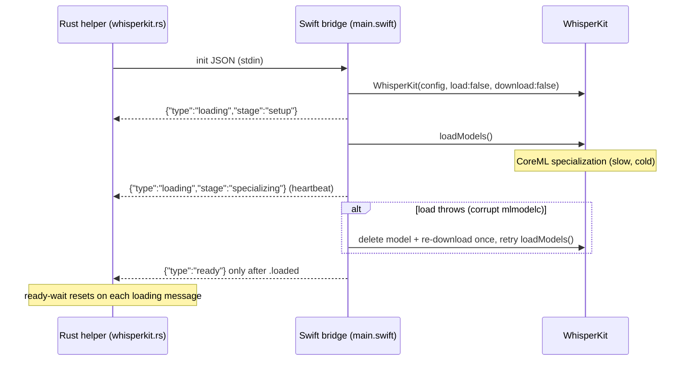

# Rewrite WhisperKit Swift bridge per Argmax recommendations

## Root cause (confirmed)
Cold CoreML specialization + HF tokenizer download makes first model load ~150s, exceeding the Rust helper's hard 120s `ready` timeout in [whisperkit.rs](tauri-app/src-tauri/src/transcription/whisperkit.rs). It worked two weeks ago because the specialization cache was warm; reboot/OS update/model re-download evicted it. No sound during the test = `ffplay` never starts because `start_headless()` fails first.

Key gap behind this request: the current `--download-only` in [setup-whisperkit.sh](tauri-app/scripts/setup-whisperkit.sh) (`"$BIN" --download-only --cache-dir ...`) downloads the CoreML models but NOT the tokenizer. Verified: the cache model folder contains only `config.json`, `generation_config.json`, and the three `.mlmodelc` dirs - no `tokenizer.json`, and no Whisper tokenizer in any HF cache. So the tokenizer is fetched from the network mid-load on every run. The fix is to make the bridge cache everything locally up front and load offline.

## Goal: everything cached locally before the test
Nothing should be downloaded during a test run. A single idempotent pre-flight must ensure the cache dir (`~/Library/Application Support/com.pavel.tauri-app/models/whisperkit`) holds: the 3 `.mlmodelc` model dirs, the model `config.json`/`generation_config.json`, the Whisper `tokenizer.json` (+ tokenizer config), and a warmed CoreML specialization. Runtime init then runs with `download: false` and a local `tokenizerFolder`, so a network outage cannot stall it.

## Load flow (new)

## Part A - Prefetch + cache everything locally (`--download-only`)
File: [main.swift](tauri-app/whisperkit-helper/Sources/WhisperkitBridge/main.swift)

- Rewrite `downloadOnly(cacheDir:)` so it fully provisions the cache, not just the CoreML models:
  1. Download CoreML model files (as today) with `useBackgroundDownloadSession: true`.
  2. Set `tokenizerFolder = cacheDir` and force the Whisper `tokenizer.json` (+ tokenizer config) to be downloaded and persisted into the cache - currently missing. Do this by running a one-time full `loadModels()` + `loadTokenizerIfNeeded()` (needs models loaded to detect the variant), which also warms CoreML specialization as a side effect.
  3. Verify on disk afterward that the 3 `.mlmodelc` dirs and `tokenizer.json` exist; throw a clear error if not.
  4. Write/extend `model-info.json` to also record the tokenizer path so the runtime + pre-flight can assert completeness.
- Emit a final `downloaded` message only after all assets are confirmed present locally.

## Part B - Rewrite runtime bridge to load offline
File: [main.swift](tauri-app/whisperkit-helper/Sources/WhisperkitBridge/main.swift)

- Split init from load: build `WhisperKitConfig` with `load: false, download: false, prewarm: false, verbose: true, logLevel: .info, modelFolder: <local>, tokenizerFolder: <cacheDir>`, then call `try await whisperKit.loadModels()` explicitly. With `download: false` + local `tokenizerFolder`, init never touches the network.
- Drop `prewarm: true` (doubles load time; long-lived single-model helper doesn't need the peak-memory tradeoff).
- Set encoder/decoder compute to `.cpuAndGPU` (via `computeOptions: ModelComputeOptions(audioEncoderCompute: .cpuAndGPU, textDecoderCompute: .cpuAndGPU)`) to avoid the M1 ANE specialization stall; keep behind an env toggle so ANE can be restored.
- Emit incremental `{"type":"loading","stage":...}` progress messages around `loadModels()` so Rust can tell "working" from "hung".
- Corrupt-model recovery: wrap `loadModels()` in do/catch; on failure, surface a clear `error` instructing to re-run setup (do NOT silently re-download at runtime - downloads belong to the pre-flight only, per this request).
- Keep the existing stdin/stdout JSON protocol and the manual `transcribe(audioArray:)` + `.vad` streaming loop (AudioStreamTranscriber is mic-only via `startRecordingLive`, so it cannot consume Rust-fed PCM).

## Part C - Enforced pre-flight cache step
Files: [setup-whisperkit.sh](tauri-app/scripts/setup-whisperkit.sh), [run-golden-test.sh](tauri-app/scripts/run-golden-test.sh), [golden_transcript.rs](tauri-app/src-tauri/tests/golden_transcript.rs)

- `setup-whisperkit.sh`: keep building the binary, then call the enhanced `--download-only` (now also fetches tokenizer + warms specialization). Make it idempotent - skip the heavy step if the cache is already complete.
- `run-golden-test.sh --e2e`: before `cargo test`, run an idempotent "ensure cache complete" step (invoke the helper's `--download-only`, which no-ops when assets already exist). This guarantees no network fetch happens inside the test.
- `golden_system_audio_e2e`: add a fast assertion that the cache contains the `.mlmodelc` dirs + `tokenizer.json` before starting; if missing, fail with "run setup-whisperkit.sh" instead of hanging.

## Part D - Make Rust ready-wait progress-aware
File: [whisperkit.rs](tauri-app/src-tauri/src/transcription/whisperkit.rs)

- Add a `Loading { stage: String }` variant to `HelperResponse`.
- In the init wait loop, reset the timeout window on each `Loading` message (slow-but-progressing specialization no longer fails), with an overall cap (e.g. 300s). Log progress via `tracing`.
- Optionally extend `validate_installation` to also check for the tokenizer file so a missing tokenizer is caught before launch.

## Part E - Rebuild and verify
- `swift build -c release` in `tauri-app/whisperkit-helper`.
- Run the pre-flight cache step; confirm `tokenizer.json` now exists in the cache dir.
- Offline smoke test: with network disabled, pipe an `init` line to the rebuilt binary and confirm it still reaches `ready` (proves nothing is fetched at runtime).
- Run golden E2E: `cd tauri-app/src-tauri && cargo test golden_system_audio_e2e -- --ignored --nocapture`; confirm `ffplay` audio plays and WER returns to ~3%.

## Notes / cleanup
- Orphaned `whisperkit-bridge` processes were seen contending during loads; ensure clean shutdown still works (Drop sends `shutdown`).
- Backups from this session: `~/Library/Application Support/com.pavel.tauri-app/models/whisperkit-backup-20260629-001255-*`.
