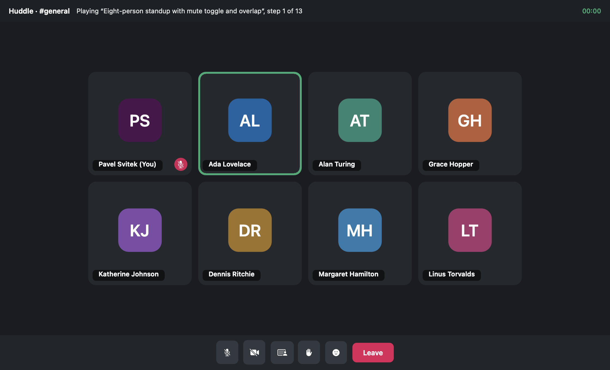

# Fake Slack

A stand-in for a running Slack Huddle, so Amie's Slack speaker identification and
local mic mute detection can be developed and tested without pulling teammates
into a live huddle.

It claims Slack's bundle id (`com.tinyspeck.slackmacgap`) and exposes the
Electron/Chromium Accessibility tree shape measured from Slack `4.50.128`
(`docs/technical/slack-huddle-speaker-detection.md`), including `AXDOMIdentifier`
and `AXDOMClassList`. A scenario script decides who speaks when, and the fake
speaks their lines aloud with macOS voices so Amie hears audio and sees the
speaker change at the same moment. It is only ever read by Amie; it needs no
permissions itself.



## Quick start

```bash
pnpm fake-slack --participants 3 --scenario conversation
```

The first run builds `build/FakeSlack.app` (about ten seconds). The huddle opens
already running; the scenario starts after a 5 second delay. The log prints in
the terminal and Ctrl-C quits.

Real Slack must be quit for live testing: the app refuses to start while
anything else runs as `com.tinyspeck.slackmacgap`, because two apps with one
bundle id would confuse Amie. Self-inspection runs (`--print-ax` and
`--snapshot`) are allowed while real Slack is open.

## Options

| Option | Meaning |
| --- | --- |
| `--participants N` | People in the huddle **including you**, 1 to 8. Default 3. (`1` mirrors a solo huddle; `8` runs full team standups.) |
| `--scenario FILE` | A scenario script: a path, or the name of a shipped one (`conversation`, `eight-person-standup`, etc.). Without it nobody speaks; click a tile to toggle its speaking mark by hand. |
| `--layout MODE` | Window layout: `compact` (default) or `full` (expanded/full-screen with `p-huddle_peer_tile__name_overlay` and `footerTarget__vxx2n`). |
| `--channel NAME` | Channel or DM name shown in the window title. Default `#general`. |
| `--muted` | Start with the local user's microphone muted (`Unmute microphone` + `Audio, Muted` + `p-huddle_peer_tile__mic_overlay`). |
| `--delay SECONDS` | Wait before the scenario starts, to press Start in Amie. Default 5. |
| `--loop` | Repeat the scenario until you quit (3 s between runs). |
| `--no-audio` | Do not speak. Speaking marks keep the timing the speech would have had. |
| `--quit-when-done` | Exit when the scenario ends. |
| `--print-ax` | Print the accessibility tree the app exposes (including `AXDOMIdentifier` and `AXDOMClassList`), then exit. |
| `--snapshot FILE` | Save a PNG of the window, then exit. |

`⌘⇧M` (or clicking the mic button in the footer) toggles local microphone mute.
`⌘R` restarts the scenario. **Leave** quits the app.

## What Amie sees

`--print-ax` reads this app's tree through the same `AXUIElementCopyAttributeValue`
calls Amie uses in `apps/amie/src-tauri/src/speakers/meeting/ax.rs`:

```bash
pnpm fake-slack --participants 3 --scenario conversation --delay 0 --no-audio --print-ax
```

Key verified vs provisional attributes (see `docs/technical/slack-huddle-speaker-detection.md`):

- **Verified from live Slack `4.50.128` & `4.53.292`:**
  - Container: `AXGroup` with `p-view_contents--huddle` → `AXTable` with `p-huddle_grid_component`
  - Local user cell: `AXCell` with `id="huddle-grid-gridcell-self_UHX8XC00G"`, `title`/`description="View Pavel Svitek's profile"`, `classes=[p-huddle_peer_tile]`
  - **Active speaker indicator:** child `AXGroup` with `classes=[p-huddle_peer_tile__mic_overlay, p-huddle_peer_tile__overlay--active_speaker, p-huddle_peer_tile__overlay--compact]` (absent when silent)
  - Mute overlay: child `AXGroup` with `classes=[p-huddle_peer_tile__mic_overlay, p-huddle_peer_tile__overlay--compact]` (without `--active_speaker`, containing `p-huddle_mic_icon`)
  - Sibling offscreen description: `id="<cell-id>-a11y_huddle_peer_tile_description"` → `AXStaticText` = `"Audio, Muted"` (muted) or `"Audio"` (unmuted, whether silent or speaking)
  - Footer toolbar (`AXToolbar` `"Huddles actions"`): `AXButton` `"Unmute microphone"` (muted) ↔ `"Mute microphone"` + `buttonToggledOn__Kuvfg` (unmuted)
- **Provisional pending multi-person huddle capture:**
  - Remote participant `AXDOMIdentifier` (`huddle-grid-gridcell-<USER_ID>`) and confirmation that remote tiles emit the same `p-huddle_peer_tile__overlay--active_speaker` class

## Development

```bash
pnpm --filter fake-slack-app test        # swift test: options, roster, scenarios, speech
pnpm --filter fake-slack-app build       # build/FakeSlack.app only
```
