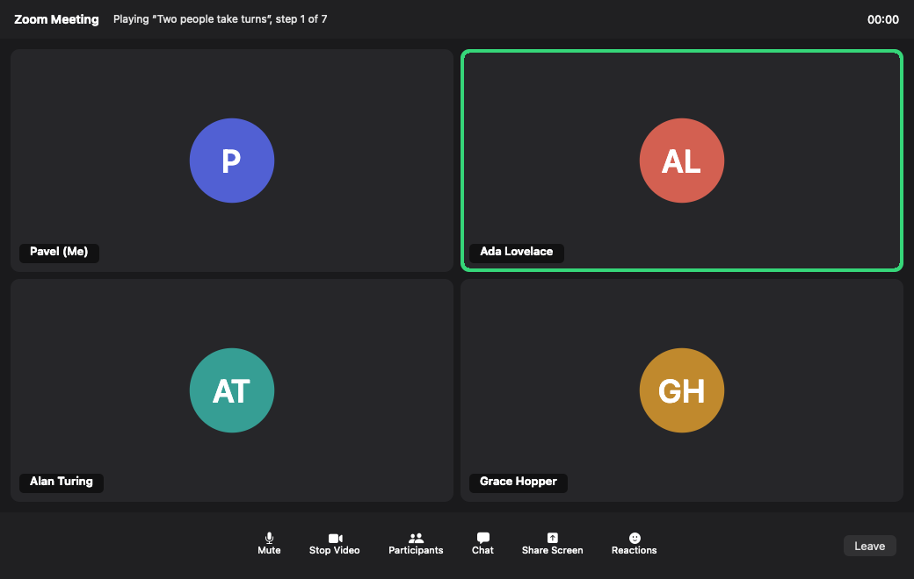

# Fake Zoom

A stand-in for a running Zoom call, so Amie's speaker names can be tested without
waiting for a real meeting.

It claims Zoom's bundle id (`us.zoom.xos`) and shows participant tiles the way
Zoom exposes them to Accessibility, as menu items named `Ada Lovelace, speaking`.
A scenario script decides who speaks when, and the fake speaks their lines
aloud with macOS voices, so Amie hears audio and sees the speaker change at the
same moment. It is only ever read by Amie; it needs no permissions itself.



## Quick start

```bash
pnpm fake-zoom --participants 3 --scenario conversation
```

The first run builds `build/FakeZoom.app` (about ten seconds). The call opens
already running; the scenario starts after a 5 second delay. The log prints in the
terminal and Ctrl-C quits.

Real Zoom must be quit: the app refuses to start while anything else runs as
`us.zoom.xos`, because two apps with one bundle id would confuse Amie.

## Testing Amie with it

1. Run Amie: `pnpm tauri dev`. Accessibility must be on for **Amie Dev** (the banner
   on New chat tells you).
2. Start the fake: `pnpm fake-zoom --participants 3 --scenario conversation`.
3. In Amie, choose a system-audio input and press **Start** during the 5 second
   countdown (`--delay` changes it). Amie captures the fake's voices from the default
   output device, so keep it unmuted and do not use `--no-audio`.
4. When the scenario ends, stop Amie and compare:

   ```bash
   pnpm fake-zoom:transcript
   ```

   It prints the latest meeting's lines with their `speaker` and `stream`. Set it next
   to the fake's log, which timestamps every START and END:

   ```
   11:31:20.114  Ada Lovelace  START  “Alan, did you get a chance to look at the latency numbers?”
   11:31:24.631  Ada Lovelace  END
   ```

Lines from your microphone (`stream = mic`) are always `User`. Lines from the call
(`stream = system`) take the name of the one remote participant marked speaking,
and stay `Remote` when nobody, nobody remote, or several people are.

## Options

| Option | Meaning |
| --- | --- |
| `--participants N` | People in the call **including you**, 2 to 6. Default 3. |
| `--scenario FILE` | A scenario script: a path, or the name of a shipped one (`conversation`). Without it nobody speaks; click a tile to toggle its speaking mark by hand. |
| `--delay SECONDS` | Wait before the scenario starts, to press Start in Amie. Default 5. |
| `--loop` | Repeat the scenario until you quit (3 s between runs). |
| `--no-audio` | Do not speak. Speaking marks keep the timing the speech would have had. |
| `--quit-when-done` | Exit when the scenario ends. |
| `--show-roster` | Open the participants panel at start. It lists names only; Amie must not mistake it for a speaking signal. |
| `--print-ax` | Print the accessibility tree the app exposes (see below), then exit. |
| `--snapshot FILE` | Save a PNG of the window, then exit. |

⌘R restarts the scenario. The **Participants** and **Leave** buttons work; the other
buttons are scenery.

## The call

The same `--participants N` always gives the same people, in this order, and a
bigger call only adds to a smaller one:

| # | Tile | Voice |
| --- | --- | --- |
| 1 | `Pavel (Me)`, the local user | Fred |
| 2 | `Ada Lovelace` | Samantha |
| 3 | `Alan Turing` | Daniel |
| 4 | `Grace Hopper` | Karen |
| 5 | `Katherine Johnson` | Tessa |
| 6 | `Dennis Ritchie` | Rishi |

Each tile's accessibility name is `Name, speaking` while marked, `Name, not speaking`
otherwise, and `Pavel (Me), unmuted` for the local user.

## Scenarios

A scenario is a JSON file. Unknown keys are errors, and every mistake names the
step it is in (`steps[2].speak: no participant 'Grace Hopper' in a 3-person call ...;
run with --participants 4 or more`).

```json
{
  "name": "Ada and Alan trade lines",
  "steps": [
    { "speak": "Ada Lovelace", "text": "Hello everyone." },
    { "pause": 1.0 },
    { "overlap": [
      { "speak": "Ada Lovelace", "text": "As I was saying" },
      { "speak": "Alan Turing", "text": "Sorry to interrupt", "lead": 1.0 } ] },
    { "speak": "Grace Hopper", "duration": 2.5 }
  ]
}
```

| Step | Meaning |
| --- | --- |
| `{ "speak": NAME, "text": "..." }` | Marks NAME speaking and says the line. `NAME` is the tile name, the name without `(Me)`, or `me`. |
| `{ "speak": NAME, "duration": 2.5 }` | A silent speaking mark for 2.5 seconds, no audio. |
| `{ "pause": 1.2 }` | Nobody speaks. |
| `{ "overlap": [ speak, speak, ... ] }` | Several people at once; ends when the last one ends. |

A `speak` step also takes `voice` (any name from `say -v '?'`), `rate` (words per
minute, 80 to 400, default 175), `lead` (seconds the mark shows before the speech
starts, default 0) and `hold` (seconds it stays after the speech ends, default 0.3).
Zoom's own indicator is not frame-exact either; `lead` and `hold` let you see how
sensitive Amie is to that.

Shipped in [scenarios/](scenarios/); the description of each says how many
participants it needs, and a test keeps that honest.

| Scenario | Participants | What Amie should do |
| --- | --- | --- |
| `monologue` | 2+ | Every call line is `Ada Lovelace`. |
| `conversation` | 3+ | Lines alternate `Ada Lovelace` and `Alan Turing`. |
| `quick-handoff` | 3+ | 0.2 s between speakers, shorter than the ASR's 800 ms silence: the speaker change has to cut the utterance. Expect Ada, Alan, Ada. |
| `interruption` | 3+ | While two people speak at once: both names joined by `;`, or `Remote`. |
| `only-me-speaking` | 2+ | The local user is never a remote name: `Remote`, then `Ada Lovelace`. |
| `full-room` | 6 | One line per remote participant, in order. |
| `silent-marks` | 4+ | No audio, so no lines: for `--print-ax` and watching the tiles. |

## What Amie sees

`--print-ax` prints the tree the app exposes, read through the same `AXUIElement`
calls Amie makes on Zoom (a process may inspect itself without the Accessibility
permission). Add `--scenario ... --delay 0` to catch the first speaker marked:

```
$ pnpm fake-zoom --participants 3 --scenario conversation --delay 0 --no-audio --print-ax
AXApplication  title="Fake Zoom"
  AXWindow  title="Zoom Meeting"  size=1040x692
    ...
    AXMenuItem  title="Pavel (Me), unmuted"  size=504x254
      AXStaticText  value="Pavel (Me)"  size=83x20
    AXMenuItem  title="Ada Lovelace, speaking"  size=504x254
      AXStaticText  value="Ada Lovelace"  size=100x20
    AXMenuItem  title="Alan Turing, not speaking"  size=504x254
      AXStaticText  value="Alan Turing"  size=88x20
```

Amie's Zoom reader (`apps/amie/src-tauri/src/speakers/zoom.rs`) takes `AXMenuItem`
nodes with a real size and reads their name; this is that shape.

## Limits

- It imitates **Zoom**, not Teams. Teams exposes a Chromium web tree (DOM ids,
  class lists, a roster pane Amie opens and closes), which this does not fake.
- It plays through the default output device, which is what Amie's system-audio
  capture hears. It does not feed your microphone.
- Pauses shorter than the ASR's end-of-utterance silence (800 ms by default, set
  with `NEMOTRON_EOU_SILENCE_MS`) may merge lines. `quick-handoff` uses that
  on purpose.

## Development

```bash
pnpm --filter fake-zoom-app test        # swift test: options, roster, scenarios, speech
pnpm --filter fake-zoom-app build       # build/FakeZoom.app only
```

`FakeZoomCore` (roster, command line, scenario files, speech) has no AppKit and is
unit tested; the speech tests run a silent stand-in for `say`. Setting
`FAKE_ZOOM_SAY` to a different executable does the same for the whole app. `FakeZoom` is the
AppKit app. `scripts/run.sh` runs the binary inside the bundle directly rather than
through `open`, so the log stays in your terminal while the bundle id is still
Zoom's. Ctrl-C and `kill` quit like ⌘Q and stop a sentence that is mid-speech.
