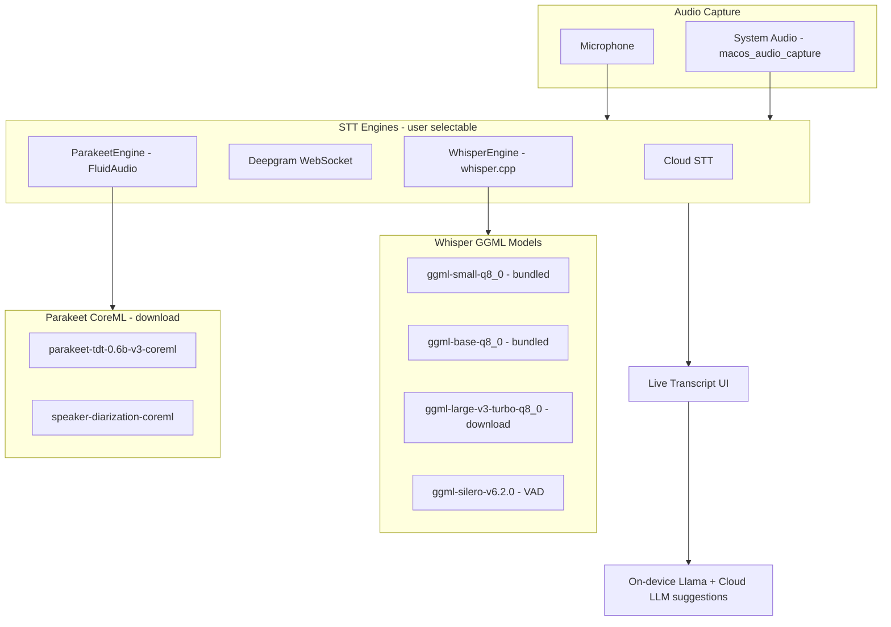
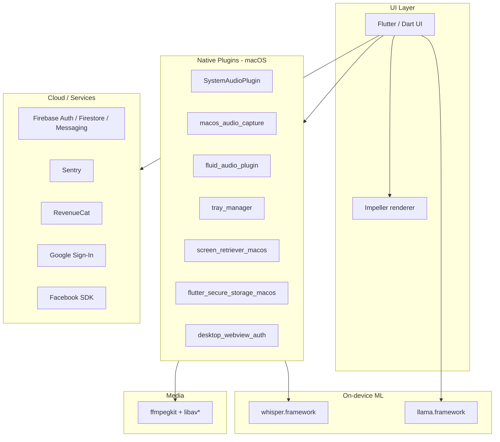

# Hedy

**Website:** [hedy.bot](https://hedy.bot)  
**Category:** Productivity — live meeting AI assistant  
**Investigated version:** 3.4.0 (build 337)  
**Install path:** `/Applications/Hedy.app`

## Product positioning

Hedy is a desktop AI assistant for meetings. It captures system and microphone audio, transcribes in real time, and provides intelligent assistance during calls. Positioned as a productivity tool (App Store category: `public.app-category.productivity`).

## App features (observed + public)

### Core capabilities

- **Live meeting assistance** — microphone access to detect meeting activity and provide in-call help
- **System audio capture** — records and analyzes audio from other apps (Zoom, Teams, Meet, etc.)
- **Real-time transcription** — multi-engine STT: Whisper (default), Parakeet (optional), Cloud STT, or Deepgram (see [Transcription architecture](#transcription-architecture))
- **On-device LLM** — local inference via bundled Llama model
- **Tray / background operation** — `tray_manager` framework; runs as a desktop utility

### Permissions & integrations

| Permission / integration | Purpose |
| --- | --- |
| Microphone | Detect meeting activity, capture user voice |
| System audio / system extension | Capture audio from other applications |
| Camera | Troubleshooting / support flows |
| Photo library | Shared media handling |
| Google Sign-In | Authentication |
| Facebook Login | Authentication |
| Sign in with Apple | Authentication |
| RevenueCat | Subscriptions / in-app purchases |
| Deep links (`hedyapp://`) | App URL scheme |
| Share extension (`ShareMedia-bot.hedy.mobile`) | Media sharing into the app |

### Distribution & updates

- **Auto-update:** Sparkle framework (`SUFeedURL` → `https://macos-update-xml.hedy.bot/appcast.xml`)
- **Analytics:** Firebase (analytics collection deactivated in plist, but Firebase SDKs bundled)
- **Crash reporting:** Sentry

## Transcription architecture

Hedy does **not** use Whisper alone for real-time transcription. Bundle inspection (v3.4.0) shows a **multi-engine STT stack** with user-selectable speech engines and automatic fallbacks.

### Speech engine types

Four `SpeechEngineType` values are exposed in settings:

| Engine | Class | Role |
| --- | --- | --- |
| `whisper` | `WhisperEngine` | Default on-device engine; always registered |
| `parakeet` | `ParakeetEngine` | Optional on-device engine; **Apple Silicon only**; labeled **(Beta)** on macOS |
| `cloud` | `CloudSTT` | Hedy cloud transcription; falls back to on-device on failure |
| `deepgram` | `DeepgramProvider` | User-supplied Deepgram API key; real-time WebSocket on macOS |

**Default behaviour:** `SessionController` defaults to `WhisperEngine` when no engine is resolved. If `ParakeetEngine` is not registered, session start falls back to Whisper. Recovery paths also default to Whisper.

**Fallback chain observed:**

```
Cloud STT failure → on-device transcription (Whisper)
Parakeet unavailable → WhisperEngine
GPU OOM on requested model → downgrade to smaller Whisper model
Whisper GPU crash → CPU mode for stability
```

### Real-time Whisper models (whisper.cpp)

Whisper runs via a **custom fork of whisper.cpp** (`hedy_bindings`) in `whisper.framework`, with **GGML Metal** acceleration on Apple Silicon and CPU-only on Intel Macs.

#### Bundled GGML models (`flutter_assets/assets/models/`)

| File | Size | Purpose |
| --- | --- | --- |
| `ggml-small-q8_0.bin` | 252 MB | Default bundled model; recommended on **Intel Mac** |
| `ggml-base-q8_0.bin` | 78 MB | Smaller/faster variant bundled alongside small |
| `ggml-silero-v6.2.0.bin` | 864 KB | Voice activity detection (VAD) for auto-pause and silence detection |

VAD model source: [ggml-org/whisper-vad](https://huggingface.co/ggml-org/whisper-vad) on Hugging Face.

#### Optional download (Settings → model size)

| File | Source | Notes |
| --- | --- | --- |
| `ggml-large-v3-turbo-q8_0.bin` | `https://dl.hedy.ai/models/ggml-large-v3-turbo-q8_0.bin` | **Recommended on Apple Silicon**; highest accuracy, especially non-English |
| `ggml-large-v3-turbo-q5_0.bin` | (referenced in binary) | Lower-bitrate variant |

UI copy: *"For Intel Macs, the 'Small' model is recommended. For newer Apple Silicon Macs, the 'Large' model is recommended."*

#### Real-time processing (WhisperEngine)

- Audio format: **16 kHz mono PCM** (`-ar 16000 -ac 1`)
- Chunked inference via `_processChunkWithWhisper` and custom bindings
- Two whisper.cpp entry points:
  - `whisper_full_short` — used for **real-time mode** (short audio windows)
  - `whisper_full` — full/batch processing (import, finalize, summary)
- Custom binding log: `run_whisper_full: strategy=%s, beam_size=%d, samples=%d`
- VAD integration: `run_whisper_configure_vad`; auto-pause requires VAD when using on-device transcription
- GPU: Metal enabled on Apple Silicon; disabled on Intel; auto-fallback to CPU if GPU prep crashes
- Custom vocabulary terms are injected into the Whisper prompt for domain jargon

#### Transcript update cadence (battery vs latency)

User setting balances real-time freshness vs power:

| Setting | Behaviour |
| --- | --- |
| Faster | Near-instant transcript updates; higher CPU/battery use |
| Normal / Slower | Less frequent updates (~2×/minute on slower); recommended when live features not needed |

### Real-time Parakeet models (FluidAudio / CoreML)

When the user enables and downloads **Local Speech Recognition (Parakeet)** (~2.5 GB), Hedy switches to the **FluidAudio** Swift SDK via `fluid_audio_plugin` and `ParakeetEngine`.

| Aspect | Detail |
| --- | --- |
| Original model | [NVIDIA Parakeet TDT 0.6B v3](https://huggingface.co/nvidia/parakeet-tdt-0.6b-v3) |
| On-device format | CoreML: `FluidInference/parakeet-tdt-0.6b-v3-coreml` |
| Streaming manager | `SlidingWindowAsrManager` (sliding-window chunked ASR) |
| Hardware | **Apple Silicon only** — strings: *"Parakeet models require Apple Silicon"* |
| Languages | English + 25 European languages; UI warns to switch to Whisper if wrong language detected |
| Status on macOS | **(Parakeet) [Beta]** |
| Model cache | `~/.cache/fluidaudio/Models` (downloaded on first use) |

**Speaker diarization** (with Parakeet): FluidInference `speaker-diarization-coreml` (pyannote + WeSpeaker embeddings). Offline re-diarization runs at session finalize via `offlineDiarize`.

### Other ASR models in FluidAudio (bundled library, not primary UI engines)

The native binary embeds FluidAudio support for additional models that may be used internally or in future builds:

| Model | Variant | Use case |
| --- | --- | --- |
| Parakeet EOU 120M | 160ms / 320ms / 1280ms chunks | True streaming ASR with end-of-utterance detection (English) |
| Parakeet TDT v2 | CoreML | English-only, higher recall |
| Parakeet CTC 0.6B / 110M | CoreML | CTC decoding variants |
| Qwen3-ASR 0.6B | f32 / int8 CoreML | Multilingual streaming (2-model pipeline) |
| Nemotron 3.5 ASR Streaming 0.6B | 320ms bundle | NVIDIA multilingual streaming ASR, app prompted to en-US |
| Cohere Transcribe 03-2026 | q8 CoreML | Cohere ASR pipeline |
| Silero VAD | CoreML (`silero-vad-coreml`) | Voice activity detection (ANE) |

Hedy's user-facing engines for live sessions are **Whisper** and **Parakeet**; the Parakeet path uses `SlidingWindowAsrManager` with TDT v3, not the separate EOU 120M model (though that code is present in FluidAudio).

### Cloud transcription

- **Cloud STT** — Hedy-hosted; `[CloudSTT] Set up real-time audio streaming for macOS`; falls back to on-device on disconnect/failure
- **Deepgram** — BYO API key; secure WebSocket; batch and streaming paths
- Cloud providers also referenced for audio normalization: OpenAI, Vertex AI (batch/post-processing, not primary live engine)

### Transcription pipeline diagram



### Answer: which model for real-time?

| Scenario | Model used |
| --- | --- |
| Default local (most users) | **Whisper `ggml-small-q8_0`** (Intel default) or user-selected size |
| Apple Silicon, user downloads large model | **Whisper `ggml-large-v3-turbo-q8_0`** |
| User enables Parakeet (Beta) | **Parakeet TDT 0.6B v3** via CoreML + `SlidingWindowAsrManager` |
| User selects Cloud STT | Hedy cloud (model not visible in bundle) |
| User provides Deepgram key | Deepgram cloud model |
| Session import / offline batch | `whisper_full` on same GGML models |

**Whisper is the default real-time engine.** Parakeet is the higher-quality optional path on Apple Silicon, not Whisper.

## Technical architecture

### Primary framework: Flutter for macOS

Hedy is **not** Electron, Tauri, or a pure native SwiftUI app. It is a **Flutter desktop application** with native plugin bridges.

| Signal | Evidence |
| --- | --- |
| Flutter engine | `Contents/Frameworks/FlutterMacOS.framework` |
| Compiled Dart app | `App.framework/.../flutter_assets/` |
| Impeller renderer | `FLTEnableImpeller` = `true` in `Info.plist` |
| Plugin registration | `FlutterPluginRegistrant` key in `Info.plist` |
| App framework ID | `io.flutter.flutter.app` |

### Bundle metadata

| Field | Value |
| --- | --- |
| Bundle ID | `bot.hedy.mobile` (shared with mobile codebase) |
| Min macOS | 14.2 |
| Architectures | Universal binary (x86_64 + arm64) |
| Copyright | Hedy AI LLC, 2026 |

### High-level architecture



### Embedded frameworks & plugins

**Audio / transcription pipeline**

- `whisper.framework` — speech-to-text
- `macos_audio_capture.framework` — system audio capture
- `fluid_audio_plugin.framework` — audio processing
- `ffmpegkit.framework` + `libavcodec`, `libavformat`, `libavutil`, etc. — media encoding/decoding
- `SystemAudioPlugin` — registered in `FlutterPluginRegistrant`

**On-device AI**

- `llama.framework` — local LLM inference

**Desktop UX**

- `tray_manager.framework` — menu bar / system tray
- `screen_retriever_macos.framework` — display/window info
- `flutter_secure_storage_macos.framework` — credential storage
- `desktop_webview_auth.framework` — OAuth in embedded webview

**Backend SDKs**

- Firebase (Analytics, Auth, Firestore, Messaging, Remote Config, Installations)
- Sentry
- Google Sign-In, Facebook SDK
- RevenueCat

### Dart packages (from bundled `flutter_assets`)

Observed in `packages/`:

- `toastification`, `lucide_icons_flutter`, `material_symbols_icons`, `nb_utils`
- `wakelock_plus`, `record_web`, `cupertino_icons`, `fluttertoast`

Fonts: Inter, Playfair Display, Onest, Material Icons, Lucide.

### Comparison to our stack

| Aspect | Hedy | Our project (direction) |
| --- | --- | --- |
| Desktop shell | Flutter macOS | Tauri (in `apps/tauri-app/`) |
| UI | Dart / Flutter widgets | Web (React) in Tauri webview |
| Transcription | Whisper.cpp (default) or Parakeet TDT v3 CoreML (optional); Cloud STT / Deepgram | Nemotron 3.5 ASR Streaming 0.6B CoreML INT8, one helper per stream |
| Live LLM suggestions | Llama (on-device) + cloud | Cloud LLM API (`apps/web/`) |
| Shared mobile codebase | Yes (`bot.hedy.mobile`) | No |

## Relevance to our product

Hedy competes in the **live meeting copilot** space with heavy emphasis on:

1. **Native audio capture** — system + mic, not a meeting bot
2. **On-device ML** — Whisper + Llama reduce latency and privacy concerns
3. **Cross-platform via Flutter** — one codebase for mobile and desktop

Our differentiation (per product docs) is the **stable 2×2 suggestion card grid** and **mode-specific live assistance** rather than post-meeting notes. Hedy appears more oriented toward real-time help and possibly post-call review via Firebase-backed sync.
