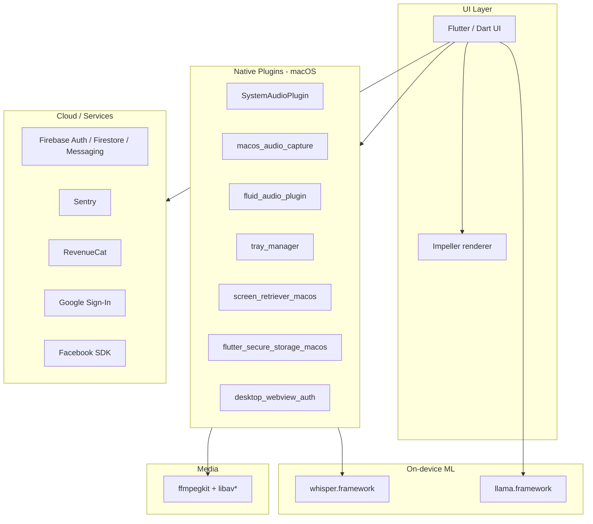

# Hedy

**Website:** [hedy.bot](https://hedy.bot)  
**Category:** Productivity — live meeting AI assistant  
**Investigated version:** 3.4.0 (build 337)  
**Install path:** `/Applications/Hedy.app`

## Product positioning

Hedy is a desktop AI assistant for meetings. It captures system and microphone audio, transcribes in real time, and provides intelligent assistance during calls. Positioned as a productivity tool (App Store category: `public.app-category.productivity`).

## App features (observed + public)

### Core capabilities

- **Live meeting assistance** — microphone access to detect meeting activity and provide in-call help
- **System audio capture** — records and analyzes audio from other apps (Zoom, Teams, Meet, etc.)
- **Real-time transcription** — Whisper-based speech recognition (see architecture)
- **On-device LLM** — local inference via bundled Llama model
- **Tray / background operation** — `tray_manager` framework; runs as a desktop utility

### Permissions & integrations

| Permission / integration | Purpose |
| --- | --- |
| Microphone | Detect meeting activity, capture user voice |
| System audio / system extension | Capture audio from other applications |
| Camera | Troubleshooting / support flows |
| Photo library | Shared media handling |
| Google Sign-In | Authentication |
| Facebook Login | Authentication |
| Sign in with Apple | Authentication |
| RevenueCat | Subscriptions / in-app purchases |
| Deep links (`hedyapp://`) | App URL scheme |
| Share extension (`ShareMedia-bot.hedy.mobile`) | Media sharing into the app |

### Distribution & updates

- **Auto-update:** Sparkle framework (`SUFeedURL` → `https://macos-update-xml.hedy.bot/appcast.xml`)
- **Analytics:** Firebase (analytics collection deactivated in plist, but Firebase SDKs bundled)
- **Crash reporting:** Sentry

## Technical architecture

### Primary framework: Flutter for macOS

Hedy is **not** Electron, Tauri, or a pure native SwiftUI app. It is a **Flutter desktop application** with native plugin bridges.

| Signal | Evidence |
| --- | --- |
| Flutter engine | `Contents/Frameworks/FlutterMacOS.framework` |
| Compiled Dart app | `App.framework/.../flutter_assets/` |
| Impeller renderer | `FLTEnableImpeller` = `true` in `Info.plist` |
| Plugin registration | `FlutterPluginRegistrant` key in `Info.plist` |
| App framework ID | `io.flutter.flutter.app` |

### Bundle metadata

| Field | Value |
| --- | --- |
| Bundle ID | `bot.hedy.mobile` (shared with mobile codebase) |
| Min macOS | 14.2 |
| Architectures | Universal binary (x86_64 + arm64) |
| Copyright | Hedy AI LLC, 2026 |

### High-level architecture

### Embedded frameworks & plugins

**Audio / transcription pipeline**

- `whisper.framework` — speech-to-text
- `macos_audio_capture.framework` — system audio capture
- `fluid_audio_plugin.framework` — audio processing
- `ffmpegkit.framework` + `libavcodec`, `libavformat`, `libavutil`, etc. — media encoding/decoding
- `SystemAudioPlugin` — registered in `FlutterPluginRegistrant`

**On-device AI**

- `llama.framework` — local LLM inference

**Desktop UX**

- `tray_manager.framework` — menu bar / system tray
- `screen_retriever_macos.framework` — display/window info
- `flutter_secure_storage_macos.framework` — credential storage
- `desktop_webview_auth.framework` — OAuth in embedded webview

**Backend SDKs**

- Firebase (Analytics, Auth, Firestore, Messaging, Remote Config, Installations)
- Sentry
- Google Sign-In, Facebook SDK
- RevenueCat

### Dart packages (from bundled `flutter_assets`)

Observed in `packages/`:

- `toastification`, `lucide_icons_flutter`, `material_symbols_icons`, `nb_utils`
- `wakelock_plus`, `record_web`, `cupertino_icons`, `fluttertoast`

Fonts: Inter, Playfair Display, Onest, Material Icons, Lucide.

### Comparison to our stack

| Aspect | Hedy | Our project (direction) |
| --- | --- | --- |
| Desktop shell | Flutter macOS | Tauri (in `tauri-app/`) |
| UI | Dart / Flutter widgets | Web (React) in Tauri webview |
| Transcription | Whisper (on-device) | TBD |
| Live LLM suggestions | Llama (on-device) + cloud | Cloud LLM API (`web/`) |
| Shared mobile codebase | Yes (`bot.hedy.mobile`) | No |

## Relevance to our product

Hedy competes in the **live meeting copilot** space with heavy emphasis on:

1. **Native audio capture** — system + mic, not a meeting bot
2. **On-device ML** — Whisper + Llama reduce latency and privacy concerns
3. **Cross-platform via Flutter** — one codebase for mobile and desktop

Our differentiation (per product docs) is the **stable 2×2 suggestion card grid** and **mode-specific live assistance** rather than post-meeting notes. Hedy appears more oriented toward real-time help and possibly post-call review via Firebase-backed sync.
