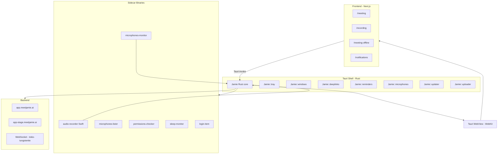

# Jamie

**Website:** [meetjamie.ai](https://www.meetjamie.ai)  
**Category:** AI meeting notes — bot-free transcription and summaries  
**Investigated version:** 5.6.38  
**Install path:** `/Applications/Jamie.app`

## Product positioning

Jamie is a **privacy-first, bot-free** meeting assistant. It does not join calls as a visible participant. Instead it captures audio locally from the Mac (microphone + system audio) and produces transcripts, summaries, action items, and searchable meeting history. Works across Zoom, Teams, Google Meet, phone calls, and in-person meetings.

Founded in Berlin (2022). GDPR-compliant, EU hosting, audio deleted after transcription (per public docs).

## App features

### Core capabilities

| Feature | Description |
| --- | --- |
| **Bot-free recording** | No meeting bot; captures device audio directly |
| **Auto meeting detection** | Monitors microphone activity to infer when a meeting is in progress |
| **Transcription** | Word-for-word transcripts with speaker identification |
| **Speaker memory** | Learns and remembers voices across meetings |
| **AI summaries** | Structured notes with decisions, action items, follow-ups (~30s–10min post-meeting per sources) |
| **Multilingual** | 99–100+ languages (public claim) |
| **Offline mode** | `meeting-offline` route and offline-capable recording (plan-dependent) |
| **Executive AI assistant** | Chat/search across past meetings, draft follow-ups |
| **Integrations** | Notion, Google Docs, OneNote, HubSpot, Slack, Trello, Gmail, etc. (public docs) |
| **Calendar integration** | Optional calendar connect for event names and participants |
| **Custom vocabulary** | Industry/company jargon recognition |

### Desktop UX patterns

- **Menu bar / background app** — `LSUIElement` = true (no dock icon by default; tray-driven)
- **System tray** — Start/Stop Recording, Open, Quit (`Jamie::tray`, `main-tray`)
- **Multiple windows/routes** — meeting UI, recording UI, notifications, offline meeting
- **Deep links** — `jamie://` URL scheme for auth, recording start, redirects
- **Quit guard** — "Jamie is recording. Are you sure you want to quit?" when active

### Permissions

| Permission | Purpose |
| --- | --- |
| `NSMicrophoneUsageDescription` | Capture user voice |
| `NSAudioCaptureUsageDescription` | Capture audio from other apps (macOS 14.2+ ScreenCaptureKit / system audio) |

### Supported deep-link targets (bundle strings)

Detected app integrations for meeting detection or deep links:

- `com.apple.Safari`
- `com.openai.atlas` (ChatGPT desktop)
- `io.aircall.phone` (Aircall)

## Technical architecture

### Primary framework: Tauri 2 + Next.js

Jamie is **not** Electron or Flutter. It is a **Tauri 2** desktop app with a **Next.js** frontend embedded in the binary.

| Signal | Evidence |
| --- | --- |
| Tauri runtime | `__TAURI_INTERNALS__`, `tauri://localhost/` |
| Tauri 2 plugins | `tauri-plugin-updater/2.10.0`, deep-link 2.4.7, shell 2.3.5, store 2.4.2, etc. |
| WebView | System **WebKit** (`WebKit.framework`) via Tauri WRY runtime |
| Frontend | `/_next/static/chunks/...` — **Next.js App Router** |
| Rust backend | `Jamie::` modules, Cargo registry paths in binary strings |
| CI build | `/Users/runner/.cargo/...` (GitHub Actions) |

### Bundle metadata

| Field | Value |
| --- | --- |
| Bundle ID | `com.jamie.app` |
| Display name | Jamie |
| Min macOS | 14.2 |
| URL scheme | `jamie://` |
| Main binary size | ~50 MB (includes embedded frontend assets) |
| Architectures | Universal binary (x86_64 + arm64) |

### High-level architecture

### Frontend routes (embedded Next.js)

Observed routes and API paths in the binary:

| Route / path | Purpose |
| --- | --- |
| `/meeting` | Main in-meeting UI (`tauri://localhost/meeting`) |
| `/meeting-offline` | Offline meeting flow |
| `/recording` | Active recording UI |
| `/notifications` | Notification center |
| `/api/external/meeting/create` | Create meeting via backend API |
| `app.meetjamie.ai` | Production web app / API host |
| `app-stage.meetjamie.ai` | Staging environment |

### Tauri plugins (from binary paths)

| Plugin | Version (observed) |
| --- | --- |
| `tauri-plugin-updater` | 2.10.0 |
| `tauri-plugin-deep-link` | 2.4.7 |
| `tauri-plugin-shell` | 2.3.5 |
| `tauri-plugin-store` | 2.4.2 |
| `tauri-plugin-fs` | 2.4.5 |
| `tauri-plugin-dialog` | 2.6.0 |
| `tauri-plugin-opener` | 2.5.3 |
| `tauri-plugin-log` | 2.8.0 |
| `tauri-plugin-os` | 2.3.2 |
| `tauri-plugin-single-instance` | 2.4.0 |
| `prevent-default` | Keyboard shortcut handling |

### Sidecar binaries (`Contents/MacOS/`)

Jamie uses **Tauri sidecars** — separate native executables spawned by the Rust shell:

| Binary | Role |
| --- | --- |
| `audio-recorder` | **Swift** — `Audio_Recorder` module, `UnifiedAudioRecorder`, captures mic + system audio via Core Audio / AVFoundation |
| `microphones-monitor` | Watches microphone activity for auto meeting detection |
| `microphones-lister` | Enumerates input devices |
| `microphone-permissions-requester` | macOS mic permission flow |
| `system-audio-permissions-requester` | System audio permission flow |
| `permissions-checker` | Validates required permissions |
| `sleep-monitor` | Handles sleep/wake during recording |
| `login-item` | Launch-at-login helper |

The `audio-recorder` sidecar is Swift (`Audio_Recorder/main.swift`), not Rust — a hybrid native architecture for low-latency audio I/O.

### Local data files (Rust strings)

| File | Likely purpose |
| --- | --- |
| `settings.bin` / `app_settings` | App configuration (Tauri store) |
| `device.bin` / `device_id` | Device identity |
| `meeting_data.bin` | Local meeting state |
| `flags.bin` | Feature flags (`Jamie::updater::flags`) |
| `update.bin` | Pending update artifact |

### IPC & events

- **Tauri invoke** — frontend ↔ Rust (`Tauri-Invoke-Key`, `Tauri-Channel-Id`)
- **Events** — `recording-status-changed`, `auth-state-changed`, `theme-changed`
- **WebSocket** — `tokio-tungstenite` for real-time backend communication
- **Tray commands** — `trayTimerEnabled`, `set_progress_bar`, badge count on dock icon

### Audio pipeline

1. **Meeting detection** — `microphones-monitor` sidecar; can be disabled via settings ("Auto-detected meetings disabled")
2. **Recording start** — tray menu, deep link, or UI; spawns `audio-recorder` sidecar
3. **Capture** — Swift `UnifiedAudioRecorder` with separate mic and system audio `AssetWriter`s
4. **Upload / processing** — `Jamie::uploader` → cloud API; transcription and summarization server-side
5. **Volume monitoring** — `phoneVolumeUpdate`, `MicrophoneVolume`, `SystemAudioVolume` events to UI

### What Jamie is NOT

- **Not Electron** — no `app.asar`, no Chromium; uses system WebKit
- **Not Flutter** — no `FlutterMacOS.framework` or `flutter_assets`
- **Not pure SwiftUI** — Swift only in audio sidecars; shell is Rust + web UI

## Comparison to our stack

| Aspect | Jamie | Our project |
| --- | --- | --- |
| Desktop shell | **Tauri 2** | Tauri (`apps/tauri-app/`) — same family |
| Frontend | Next.js (embedded) | React + Vite (planned in Tauri) |
| Audio capture | Swift sidecar | TBD |
| ML / LLM | Cloud (GPT-4, Claude per public docs) | Cloud LLM API (`apps/web/src/lib/llm/`) |
| Live assistance | Post-meeting focus + in-meeting UI | **Live 2×2 suggestion cards** during call |
| Meeting detection | Mic activity monitoring | TBD |
| Distribution | Tauri updater plugin | TBD |

Jamie is the closest architectural peer in this research set: **Tauri + web frontend + native audio sidecars**. The main product difference is Jamie's emphasis on **transcripts and post-meeting summaries** versus our **real-time structured suggestion cards** during live conversations.

## Relevance to our product

Strengths to note:

1. **Bot-free positioning** — strong privacy story; no calendar bot awkwardness
2. **Proven Tauri 2 production app** — validates our desktop direction
3. **Sidecar pattern for audio** — Swift/Core Audio isolated from Rust shell; good reference for `tauri-app`
4. **Tray-first UX** — background app with start/stop from menu bar
5. **Offline route** — separate `meeting-offline` flow for connectivity-limited scenarios

Gaps relative to our vision:

1. No evidence of a **live copilot card grid** — UI routes point to meeting/recording, not real-time coaching surfaces
2. Summaries appear **post-meeting** rather than continuous in-call suggestions
3. Heavy cloud dependency for transcription vs on-device Whisper (contrast with Hedy)
