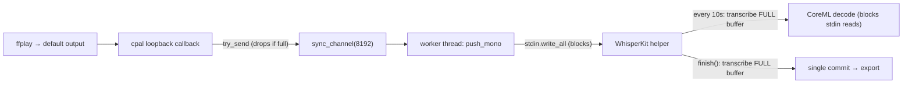

# Closing the E2E WER Gap — Detailed Fix Plan

A detailed, implementation-level companion to [golden-test-wer-gap.md](./golden-test-wer-gap.md). That doc explains **why** the file pipeline scores ~3% WER while the system-audio E2E scores ~18%. This doc specifies **how to fix it**, with concrete code changes, ordering, validation, and risk for each fix.

**Target:** system-audio E2E WER **&lt; 5%** on `test-youtube-video.mp4`, ideally approaching the file pipeline's ~3%.

## TL;DR

The gap is caused by **lost audio during live capture**, not model quality. The dominant mechanism:

1. The Swift helper re-transcribes the **entire growing buffer** every 10 s to emit a UI partial.
2. While it transcribes, it stops reading stdin.
3. The Rust worker blocks writing the next chunk, the bounded channel fills, and cpal's callback **silently drops frames** (`try_send`).
4. Dropped frames become permanent gaps in the audio the model finally transcribes on `finish()`.

The fix strategy, in order:

1. **F1 — Never drop audio** (decouple capture from inference with a ring/queue that doesn't silently discard).
2. **F2 — Make partial transcription stop blocking ingestion** (background it, window it, or disable in headless).
3. **F3 — Gate playback on capture-ready** (kill the fixed 4 s sleep).
4. **F4 — Instrument the E2E test** so we can prove which fix worked.
5. **F5–F7 — Level normalization, incremental commits, better resampler** (secondary).

Recommended first move: implement **F4 (instrumentation)** + a quick **F2 spike (disable partials in headless)** to confirm the root cause cheaply before larger refactors.

---

## Current architecture (the relevant slice)



The two backpressure points:

- **`cpal_capture.rs`** — callback drops on full channel (data loss origin).
- **`whisperkit.rs`** — `push_mono` → `stdin.write_all` blocks while the helper is busy decoding.
- **`main.swift`** — `emitRealtimePartial()` and `finish()` both call `transcribe(audioArray: accumulatedSamples)` over the **whole** buffer; cost grows with clip length.

---

## F1 — Never drop audio (highest impact)

**Goal:** Guarantee every captured sample reaches the helper, even when the helper stalls.

### F1.a — Decouple capture from inference with a non-dropping queue

Today the cpal callback sends directly into the same bounded channel the worker drains, and the worker blocks on the helper. Instead:

- Capture callback pushes into an **unbounded-but-capped ring buffer** (or a large `VecDeque` behind a mutex) that **never discards** under normal clip lengths.
- A dedicated drain step moves audio to the helper at the helper's pace.

The audio callback must remain real-time-safe (no blocking, no allocation-heavy work), so the callback should do a **lock-free or try-lock push** into a preallocated ring. If the ring is full (true overflow), increment an **explicit dropped-samples counter** rather than silently warning.

**Sketch (capture side):**

```rust
// Replace try_send-drop with a push that records overflow explicitly.
move |data: &[T], _: &cpal::InputCallbackInfo| {
    let mono = downmix_interleaved(data, channels);
    if let Err(overflowed) = ring.push_slice(&mono) {
        dropped_samples.fetch_add(overflowed, Ordering::Relaxed);
    }
}
```

**Sizing:** the golden clip is short (tens of seconds). At 48 kHz mono f32, 60 s ≈ 2.88M samples ≈ 11.5 MB. A ring sized for the **entire clip** is trivially affordable for the test and a generous bound for production (e.g. cap at 5–10 min, then drop oldest with a counter).

### F1.b — Stop blocking the worker on the helper

`push_mono` currently blocks on `stdin.write_all` while the helper is decoding. Even with a ring buffer feeding the worker, the worker→helper write can still stall. Options:

1. **Larger OS pipe / async write** — write audio on a separate thread so capture-drain never waits on the helper.
2. **Backpressure-aware drain** — the drain loop reads from the ring and writes to the helper; if the helper is slow, audio simply accumulates in the ring (bounded, counted) instead of being dropped at the callback.

The key invariant: **the only place audio can be lost is an explicit, counted ring overflow** — never a silent `try_send` failure mid-callback.

### Validation

- Run E2E; assert `dropped_samples == 0` for the golden clip.
- Compare captured sample count to `video_duration * 48000` (should match within VAD/silence trim tolerance).
- Expect E2E WER to fall toward file WER (~3%) if H1 is the dominant cause.

### Risk

- Audio callback correctness (real-time safety) is the main risk; use a tested SPSC ring (e.g. `ringbuf` crate) rather than a hand-rolled mutex in the callback.
- Memory growth if production sessions are long — bound the ring and keep the counter.

---

## F2 — Make partial transcription stop blocking ingestion (high impact)

Even with F1, the helper periodically goes silent on stdin while it decodes the full buffer. F2 removes that stall at its source. Three independent options, usable alone or together.

### F2.a — Disable partials in headless / test mode (fastest spike)

The golden E2E only scores the **final commit**. Partials add nothing to WER but cause every stall. Gate them off when running headless.

- Add an env flag (e.g. `WHISPERKIT_DISABLE_PARTIALS=1`) read by the Swift helper, or pass a field in the `init` message.
- When set, `pushAudio` only accumulates; it never calls `emitRealtimePartial()`. Only `finish()` transcribes.

This makes the E2E ingestion path behave like the file path (accumulate-then-finish). **If this alone brings E2E to ~3%, H1/H2 are confirmed** and we know the partial loop is the culprit.

**Swift sketch:**

```swift
func pushAudio(base64PCM16: String) async throws {
    let samples = try decodePCM16(base64PCM16, sampleRate: inputSampleRate)
    accumulatedSamples.append(contentsOf: samples)
    guard !disablePartials else { return }            // headless: accumulate only
    guard accumulatedSamples.count - lastTranscribedSampleCount >= minimumRealtimeSamples else { return }
    lastTranscribedSampleCount = accumulatedSamples.count
    try await emitRealtimePartial()
}
```

### F2.b — Window the partials instead of re-scanning the whole buffer

Production still wants live partials. The cost problem is that each partial transcribes **all** accumulated audio. Instead, transcribe only a **rolling tail window** (e.g. last 15–30 s) for partials, and keep the full-buffer transcription only for `finish()`.

- Bounds per-partial decode cost to a constant, so the stall window stops growing with clip length.
- Aligns with Argmax/WhisperKit streaming guidance (rolling window + confirmed-prefix).

This is the structural fix for live UX latency, independent of the test.

### F2.c — Background the decode so stdin keeps draining

Make the helper continue reading stdin and appending audio **while a partial decode runs** on a separate task. Serialize decodes (one at a time) but never let an in-flight decode block audio intake.

- `StreamSession` is already an `actor`; move the decode into a detached task with a "decode in progress" flag; skip launching a new partial if one is running.
- Ensures the OS pipe never backs up, which removes the worker stall and thus the capture stall.

### Validation

- With F2.a: E2E WER should approach file WER; partial-induced stalls eliminated.
- With F2.b/c: measure max time helper spends not reading stdin (should be bounded/near-zero); WER stable across clip lengths.

### Risk

- F2.b changes live transcript behavior; verify partial quality and that `finish()` still produces the full transcript.
- F2.c concurrency: ensure no data race on `accumulatedSamples` (actor isolation helps; be careful with detached tasks capturing buffer snapshots).

---

## F3 — Gate playback on capture-ready (medium impact)

Replace the fixed `thread::sleep(4s)` before `ffplay` with a real readiness signal, so no leading words are clipped and runs are deterministic.

### F3.a — Expose a capture-ready signal from the service

- `TranscriptionService` sets a ready flag (or sends a `Status` event) once the cpal stream is `play()`-ing **and** the first non-silent loopback chunk has arrived.
- The E2E test waits on that signal (with a timeout) before spawning `ffplay`.

### F3.b — Gate on first audio frame in the test

Lighter-weight: have the test poll until the worker reports it has received the first audio chunk (e.g. via a test-only counter or status event), then start playback.

### Validation

- Leading-word deletions in `e2e-transcript.txt` disappear.
- Run-to-run WER variance shrinks.

### Risk

- Low. Mostly test-harness plumbing. Keep a generous timeout so the test fails loudly rather than hanging.

---

## F4 — Instrument the E2E test (do this first)

Before refactoring, make the failure measurable. Add telemetry to the golden E2E and/or the worker:

| Metric | Where | Confirms |
| --- | --- | --- |
| Dropped-frame / dropped-sample count | `cpal_capture.rs` (counter) | H1 frame drops |
| Captured duration vs video duration | E2E test (sample count ÷ rate) | H1/H4 loss or truncation |
| Time worker blocked on `stdin.write_all` | `whisperkit.rs` (timing around write) | H1 backpressure |
| Partial decode count + wall-clock each | `main.swift` (stderr log) | H1 stall growth |
| Captured RMS/peak vs ffmpeg decode RMS/peak | E2E vs diagnostic | H3 level/fidelity |
| First-loopback-frame timestamp vs ffplay start | E2E test | H2 capture-ready |

Surface counters through the existing `tracing` logs (worker already logs; `cpal_capture.rs` already warns on drop — upgrade to a counter) and print a summary line at the end of the E2E test next to the WER line.

**Concrete E2E additions:**

- After `stop()`, log `captured_samples`, `expected_samples`, `dropped_samples`, `partial_passes`.
- Save the captured audio to `test-output/diagnostic/e2e-captured.f32` so it can be diffed/spectrogram'd against the ffmpeg decode used by the file diagnostic.

### Risk

- None functional; this is observability. Keep it cheap (counters, one summary line).

---

## F5 — Loopback level normalization (secondary)

If F1+F2 close most of the gap but a residual remains, address capture fidelity.

- **Normalize** captured audio (peak or RMS) to match the ffmpeg-decoded reference level before `push_mono`, or inside the helper before decode.
- **Fix `ffplay` volume** in the golden test (`-volume 100`) for run-to-run consistency.
- **Compare spectrograms** of `e2e-captured.f32` vs the file diagnostic's decode to spot EQ/clipping differences.

**Risk:** Over-normalization can amplify noise floor in silence; clamp and only normalize when peak is below target.

---

## F6 — Incremental commits in the helper (product UX, orthogonal to the gate)

Today the helper commits **only on `finish()`**, so:

- `committed-only` in the file diagnostic is always empty (100% WER artifact).
- The live UI shows partials but never stabilizes text mid-session.

Implement VAD-aligned **incremental commits**: when a VAD segment closes, transcribe just that segment, emit a `commit`, and trim it from `accumulatedSamples`. `finish()` then only flushes the trailing partial segment.

**Why it matters for the gap:** it doesn't directly lower the final-commit WER (export still concatenates commits), but it:

- Bounds buffer growth (helps F2 cost).
- Makes `committed-only` a meaningful diagnostic.
- Aligns with the documented "live partial + stabilized commit" design in [realtime-transcription.md](./realtime-transcription.md).

If export switches to concatenated incremental commits, **verify the duplicate-bigram collapse** (currently only in `finish()`) runs across segment boundaries to avoid the `duplicate_bigram_count` assertion failing.

**Risk:** Segment-boundary word splitting and double-counting; needs careful overlap handling and the bigram-collapse guard the E2E test already asserts on.

---

## F7 — Replace the naive linear resampler (low impact for this gap)

Both paths share the helper's linear 48→16 kHz interpolator, so it does **not** explain the 15-point delta. But a sinc/polyphase resampler (e.g. `rubato` on the Rust side, or a higher-quality path in Swift) is a quality win for both pipelines and worth doing once the gap is closed.

**Risk:** Adds a dependency and a resample stage; keep sample-rate handling consistent between Rust capture and Swift decode (avoid double-resampling).

---

## Recommended execution order

1. **F4** — instrument E2E (drops, captured duration, partial timing, captured audio dump).
2. **F2.a** — disable partials in headless; re-run. If WER → ~3%, root cause confirmed.
3. **F1** — replace `try_send`-drop with a non-dropping ring; assert zero drops.
4. **F2.b/c** — windowed/background partials so production keeps live UX without stalls.
5. **F3** — gate playback on capture-ready; remove fixed sleeps.
6. Re-measure; if stable, **lower the gate** to `GOLDEN_E2E_MAX_WER=0.05`.
7. **F5 / F7** — only if a residual gap remains.
8. **F6** — schedule independently for product UX.

### Exit criteria

- E2E WER &lt; 5% across **3 consecutive runs** on an otherwise idle machine.
- `dropped_samples == 0` and `captured_duration ≈ video_duration` in the E2E summary.
- `duplicate_bigram_count == 0` assertion still passes.

---

## Per-fix summary

| Fix | Addresses | Impact | Risk | Effort |
| --- | --- | --- | --- | --- |
| F1 — Non-dropping capture | H1 | **High** | Medium (RT-safe ring) | Medium |
| F2.a — Disable partials (headless) | H1/H2 | High (test) | Low | Low |
| F2.b — Windowed partials | H1 | High (prod) | Medium | Medium |
| F2.c — Background decode | H1 | High | Medium (concurrency) | Medium |
| F3 — Capture-ready gate | H2 | Medium | Low | Low |
| F4 — Instrumentation | all | Diagnostic | None | Low |
| F5 — Level normalization | H3 | Low–Med | Low | Low |
| F6 — Incremental commits | UX/H5 | Low (gap) / High (UX) | Medium | Medium |
| F7 — Better resampler | shared | Low (gap) | Low | Low |

## Code touch-points

| Fix | Files |
| --- | --- |
| F1 | `cpal_capture.rs`, `service.rs` (channel/ring), `worker.rs` (drain) |
| F2.a | `main.swift` (`pushAudio`), `whisperkit.rs` (init flag), `golden_transcript.rs` (env) |
| F2.b/c | `main.swift` (`StreamSession`, `emitRealtimePartial`, `transcribeText`) |
| F3 | `service.rs` (ready signal), `golden_transcript.rs` (wait), `ipc/transcript` (status) |
| F4 | `cpal_capture.rs` (counter), `worker.rs` (timing), `golden_transcript.rs` (summary), `main.swift` (stderr metrics) |
| F5 | `worker.rs` or `main.swift` (normalize), `golden_transcript.rs` (`ffplay -volume`) |
| F6 | `main.swift` (VAD commits), `whisperkit.rs` (commit handling), `worker.rs` |
| F7 | `main.swift` (`resampleLinear`) or Rust capture resample stage |
