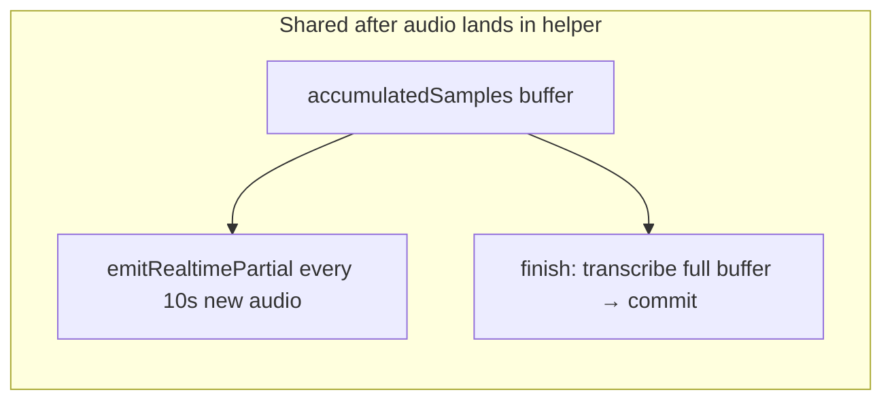

# Golden Test WER Gap: File Pipeline vs E2E

Why the WhisperKit **file pipeline** scores ~3% WER while the **system-audio E2E** golden test can score ~18% WER on the same reference clip (`test-youtube-video.mp4` / `test-youtube-video.txt`), even though both paths use the same model, helper, and decoding options.

Related docs:

- [macos-capturing-audio.md](./macos-capturing-audio.md) — loopback capture architecture
- [realtime-transcription.md](./realtime-transcription.md) — streaming transcription design
- `tauri-app/src-tauri/tests/golden_diagnostic.rs` — file pipeline diagnostic
- `tauri-app/src-tauri/tests/golden_transcript.rs` — headless E2E golden test

## Observed numbers

| Path | Metric | Typical WER | Notes |
| --- | --- | --- | --- |
| File pipeline | `committed+finish` | **~2.8%** | ffmpeg decode → `push_mono` → `finish()` |
| File pipeline | `committed-only` | **100%** (empty) | WhisperKit helper emits commits only on `finish()` |
| E2E headless | exported transcript | **~18.4%** | loopback capture → worker → `finish()` |

The file pipeline proves the **model and decoder are healthy**. The E2E gap is almost certainly **audio fidelity and real-time ingestion**, not model quality.

> **Historical note:** `MODEL_INVESTIGATION.md` records a June 2026 run where E2E also hit ~2.8%. That suggests the gap is **environment- and timing-dependent** (frame drops, capture window, system load), not a fixed property of loopback itself.

## Shared pipeline (what is identical)

Both paths converge on the same stack:

1. **Model:** WhisperKit `large-v3-v20240930_626MB`
2. **Helper:** `whisperkit-bridge` Swift process (JSON over stdin/stdout)
3. **Decoding:** `DecodingOptions` with `language` from config, `temperature: 0.0`, `chunkingStrategy: .vad`
4. **Resampling:** 48 kHz input → 16 kHz via the same linear interpolator in the helper
5. **Final transcript:** one `commit` from `finish()` that transcribes the **entire accumulated buffer**



The helper does **not** incrementally commit during streaming. Partials are emitted for UI feedback only; WER is scored against the single final commit (or the concatenation of commits, of which there is typically one).

## What each test actually does

### File pipeline (`diagnose_model_vs_commit_strategy`)

**Purpose:** isolate model quality from capture loss.

1. `ffmpeg` decodes `test-youtube-video.mp4` to mono f32 at **48 kHz** (lossless, complete)
2. PCM is fed in **1024-sample chunks** (~21 ms) via `push_mono` — mimicking cpal callback size, but **without real-time pressure**
3. `finish()` flushes the final commit
4. WER is computed for `committed-only` and `committed+finish`

**Key property:** every sample reaches the helper. Ingestion can block while the helper transcribes; nothing is dropped.

### E2E headless (`golden_system_audio_e2e`)

**Purpose:** validate the full production path — capture, worker, export — against the golden reference.

1. `TranscriptionService::start_headless(AudioSource::SystemAudio)`
2. **Sleep 4 s** (model load + loopback setup)
3. `ffplay -autoexit -nodisp` plays the mp4 through the **default output device**
4. macOS **Core Audio loopback** (cpal) re-captures output as mono f32
5. Worker forwards chunks to WhisperKit helper via bounded `sync_channel`
6. **Sleep 8 s** after playback ends (VAD / flush margin)
7. `stop()` → worker `finish()` → export `TranscriptStore` text
8. WER vs `test-youtube-video.txt`; default gate `GOLDEN_E2E_MAX_WER=0.05` (5%)

**Key property:** audio is captured **live** under backpressure. Frames can be **dropped** when the pipeline cannot keep up.

```mermaid
flowchart TB
    subgraph file ["File pipeline"]
        FF["ffmpeg decode"]
        PUSH["push_mono (blocking OK)"]
        FF --> PUSH --> H1["WhisperKit helper"]
    end

    subgraph e2e ["E2E pipeline"]
        PLAY["ffplay → speakers"]
        LOOP["cpal loopback tap"]
        CHAN["sync_channel (8192 slots)"]
        WORK["worker thread"]
        PLAY --> LOOP --> CHAN --> WORK --> H2["WhisperKit helper"]
    end

    H1 --> WER1["~2.8% WER"]
    H2 --> WER2["~18% WER"]
```



## Differences that matter

### 1. Lossless decode vs lossy live roundtrip

| | File | E2E |
| --- | --- | --- |
| Audio source | Direct PCM from file | Speaker output → loopback re-capture |
| Sample completeness | Guaranteed | Depends on capture + backpressure |
| Extra processing | None | System output volume, EQ, other apps |
| Clock | N/A (offline) | Real-time; drift between playback and capture |

The E2E path adds a **DAC → air/virtual tap → ADC** roundtrip (or virtual equivalent). Any clipping, level mismatch, or concurrent system sounds affect WER.

### 2. Frame dropping under backpressure (primary suspect)

cpal's input callback uses **non-blocking** send:

```rust
if sender.try_send(mono).is_err() {
    tracing::warn!("Audio channel full, dropping frame");
}
```

When the channel is full, **audio is discarded permanently**.

Backpressure chain:

1. Every **10 s** of new audio (`minimumRealtimeSamples`), the helper runs `emitRealtimePartial()`
2. That calls `whisperKit.transcribe()` on the **entire accumulated buffer** — cost grows with clip length
3. While Swift is transcribing, it is not reading stdin
4. Rust worker blocks on `stdin.write_all` when sending the next audio chunk
5. Channel fills → cpal drops frames

**Asymmetry:** In the file path, `push_mono` simply waits; all samples eventually arrive. In E2E, dropped frames create **gaps and discontinuities** in `accumulatedSamples`. WhisperKit's VAD chunking and long-context decode are sensitive to missing segments → substitutions, deletions, and hallucinated glue text.

This failure mode **worsens over longer clips** because each partial re-scans more audio and blocks longer.

### 3. Partial transcription is UI-only, not WER-relevant

During streaming, the helper emits `partial` messages but **no `commit`** until `finish()`. The worker only appends **commits** to `TranscriptStore`:

```rust
if let TranscriptEvent::Commit(c) = &event {
    transcript.append_commit(&c.text);
}
```

So:

- `committed-only` WER in the file diagnostic is **always empty** for WhisperKit (100% WER artifact, not a model failure)
- E2E WER reflects the **single final commit** after `finish()`, same as `committed+finish` in the file test
- Partials do not improve E2E WER today

### 4. Fixed capture-window timing

E2E uses hard-coded sleeps:

- **4 s** before `ffplay` — assumes model + loopback are ready; if loopback starts late, **leading words are lost**
- **8 s** after `ffplay` ends — flush margin; too short may truncate tail; too long adds idle silence (usually harmless)

There is no handshake that loopback is actually capturing before playback starts.

### 5. Export semantics

E2E export is `TranscriptStore::text()` — space-joined commit segments. With WhisperKit's current helper, that is effectively **one segment**. Duplicate-bigram collapse runs only in Swift `finish()`, not on partials.

### 6. Identical decoding does not mean identical input

Both paths resample 48 kHz → 16 kHz with the same **naive linear** interpolator. That is not the main WER gap (both share it), but a higher-quality resampler (e.g. sinc) would benefit both equally.

## Hypotheses (ranked)

### H1 — Frame drops during partial transcription (high confidence)

**Claim:** E2E WER is dominated by cpal dropping frames while the helper blocks on full-buffer re-transcription every 10 s.

**Evidence:**

- File path (no drops) → ~2.8%
- E2E (live path with `try_send`) → ~18%
- Helper blocks on growing `transcribe(audioArray: accumulatedSamples)` calls
- `tracing::warn!("Audio channel full, dropping frame")` is the smoking gun when it appears in logs

**Predictions:**

- E2E WER correlates with system load and clip length
- Logs show frame-drop warnings during E2E runs
- Disabling or deferring partial transcription improves E2E WER without changing the model

### H2 — Loopback not ready before playback (medium confidence)

**Claim:** The 4 s pre-roll is insufficient or non-deterministic; `ffplay` starts before loopback delivers audio, clipping the start of the reference.

**Evidence:**

- Fixed sleep, no capture-ready signal
- WER deletions often cluster at transcript start

**Predictions:**

- Increasing pre-roll or gating `ffplay` on first non-silent loopback frame reduces leading deletions
- Shorter test clips show smaller E2E vs file gap

### H3 — Loopback fidelity / level (medium confidence)

**Claim:** System output level, format, or processing degrades SNR enough to hurt Whisper on loopback but not on ffmpeg decode.

**Evidence:**

- Loopback is a second hop through the audio stack
- No gain normalization in capture path

**Predictions:**

- Normalizing captured RMS to match ffmpeg decode improves WER
- Running ffplay at a fixed volume reduces variance between runs

### H4 — Tail truncation (low–medium confidence)

**Claim:** 8 s post-roll is sometimes insufficient if `finish()` runs before the last loopback buffers drain.

**Evidence:**

- Hard-coded sleep after `ffplay` exits
- Worker `finish()` only runs after `stop()` joins

**Predictions:**

- WER deletions cluster at transcript end
- Longer post-roll or explicit drain-before-stop reduces tail deletions

### H5 — Commit strategy / empty committed-only (context only)

**Claim:** The file diagnostic's `committed-only` metric is misleading for WhisperKit.

**Evidence:**

- Helper only commits on `finish()`
- `committed+finish` matches E2E export semantics

**Not a cause of the 3% vs 18% gap** — both scored paths use the finish commit.

### H6 — Historical 2.8% E2E was a lucky run (medium confidence)

**Claim:** Loopback E2E can pass when the machine is idle, cache is warm, and no frames drop; regression to ~18% reflects load, timing, or helper changes that increased partial-transcription cost.

**Evidence:**

- `MODEL_INVESTIGATION.md` documents 2.8% E2E on June 17, 2026
- Current runs at ~18% on same clip

**Predictions:**

- Re-running E2E under controlled conditions (no other apps, warm model) may approach file WER
- Instrumentation will show whether drops occurred in the "good" vs "bad" runs

## Fix hypotheses (target: E2E WER &lt; 5%)

Ordered by expected impact and implementation risk.

### F1 — Stop dropping audio (highest impact)

**Options:**

1. **Block in cpal callback** instead of `try_send` — use a larger bounded channel or an unbounded channel with memory cap policy; never drop silently
2. **Decouple capture from inference** — dedicated capture thread writes to a ring buffer; worker reads at its own pace; drops only if ring overflows (with explicit metrics)
3. **Spill to disk** for golden E2E — overkill for production, useful for diagnosis

**Rationale:** If H1 is correct, eliminating drops should bring E2E WER close to file WER (~3%).

### F2 — Make partial transcription non-blocking (high impact)

**Options:**

1. **Disable partials during E2E / headless** — only transcribe on `finish()` for tests (matches file path behavior)
2. **Incremental / windowed partials** — transcribe only the last N seconds, not the full buffer (Argmax-style streaming)
3. **Async partial on a background task** — continue draining stdin while a prior partial runs; serialize decode if needed but never block audio ingestion
4. **Raise `minimumRealtimeSamples`** — fewer partials, fewer block windows (worse live UX, better E2E)

**Rationale:** Removes the root cause of backpressure without changing the model.

### F3 — Gate playback on capture ready (medium impact)

**Options:**

1. Wait for first loopback chunk (or N ms of non-silent audio) before spawning `ffplay`
2. Replace fixed 4 s sleep with `wait_until_ready()` on the transcription service
3. Record loopback start timestamp vs first commit for test telemetry

**Rationale:** Addresses H2; cheap to implement in the golden test.

### F4 — Improve golden test observability (medium impact, diagnostic)

**Add metrics to E2E runs:**

- Count of `"Audio channel full, dropping frame"` warnings
- Captured duration vs expected video duration
- RMS / peak level of captured audio vs ffmpeg decode
- Time spent blocked on helper stdin
- ASR pass count and wall-clock time per partial

**Rationale:** Confirms which hypothesis applies before larger refactors.

### F5 — Loopback level normalization (lower impact)

**Options:**

1. Peak or RMS normalize captured audio before `push_mono`
2. Fix `ffplay` volume (`-volume` flag) in the golden test
3. Compare spectrograms of file vs E2E captured WAV (save intermediate artifact in diagnostic)

**Rationale:** Addresses H3 if drops are already fixed.

### F6 — Incremental commits for production UX (orthogonal to E2E gate)

Implement true streaming commits in the Swift helper (VAD-aligned segments) so:

- Live UI populates during streaming
- `committed-only` diagnostic becomes meaningful
- Final `finish()` only flushes tail audio

**Rationale:** Does not directly fix E2E WER if export still uses one finish commit, but aligns product behavior with streaming expectations.

### F7 — Replace naive resampler (low impact for this gap)

Use a proper sinc/polyphase resampler in the helper for 48 kHz → 16 kHz.

**Rationale:** Quality improvement for both paths; unlikely to explain 15+ point WER delta alone.

## Recommended investigation order

1. **Re-run E2E with RUST_LOG / tracing** and count frame-drop warnings
2. **Run file diagnostic and E2E back-to-back** on the same machine; compare `test-output/diagnostic/` vs `e2e-transcript.txt` length and word count
3. **Spike F2 option 1** — disable partial transcription in headless mode; if E2E WER drops to ~3%, H1 is confirmed
4. **Spike F1** — block instead of drop; measure again
5. **Implement F3** in golden test for stable capture windows
6. Lock E2E gate at **5%** (`GOLDEN_E2E_MAX_WER=0.05`) once stable

## Code map

| Concern | Location |
| --- | --- |
| E2E test orchestration | `tauri-app/src-tauri/tests/golden_transcript.rs` |
| File pipeline diagnostic | `tauri-app/src-tauri/tests/golden_diagnostic.rs` |
| Frame drop on full channel | `tauri-app/src-tauri/src/transcription/cpal_capture.rs` |
| Channel bound (8192 chunks) | `tauri-app/src-tauri/src/transcription/service.rs` |
| Worker → helper blocking | `tauri-app/src-tauri/src/transcription/whisperkit.rs` |
| 10 s partial threshold | `tauri-app/whisperkit-helper/.../main.swift` (`minimumRealtimeSamples`) |
| Full-buffer transcribe | `StreamSession.transcribeText(for:)` in `main.swift` |
| Commit only on finish | `StreamSession.finish()` in `main.swift` |
| Golden test runner | `tauri-app/scripts/run-golden-test.sh` |

## Summary

The file pipeline and E2E test share the same WhisperKit brain but different **ears**. The file path delivers every sample reliably; the E2E path captures audio in real time and **drops frames** when partial transcription blocks the pipeline. That is the most plausible explanation for ~3% vs ~18% WER on the same reference clip. Fixing ingestion backpressure and gating playback on capture readiness are the highest-leverage paths to **E2E WER under 5%**.
