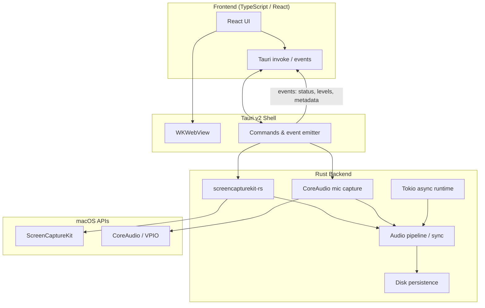

# macOS App Architecture (Tauri + Rust + React)

Architecture and technical constraints for the native macOS desktop app: **TypeScript/React frontend**, **Rust backend**, **Tauri v2** shell.

For microphone echo, clock drift, VPIO trade-offs, and dual-track diarization rationale, see [macos-capturing-audio.md](./macos-capturing-audio.md).

## Chosen Stack

| Layer | Technology | Role |
| --- | --- | --- |
| Presentation | TypeScript, React, Vite | UI, session orchestration, live suggestion cards |
| Shell | Tauri v2 | Windowing, menu bar, permissions, IPC, distribution |
| Systems | Rust | ScreenCaptureKit, CoreAudio, audio pipeline, file I/O |
| Renderer | WKWebView (macOS native) | Hosts the React frontend — no bundled Chromium |

**Why not Electron:** baseline bundles are ~150–200 MB+, idle RAM ~150–400 MB+, startup 2–5 s. Unacceptable for a background VoIP capture utility.

**Why Tauri over Go/Wails:** CoreAudio and ScreenCaptureKit callbacks fire hundreds of times per second. Go's CGo boundary causes thread pinning, scheduler contention, and latency spikes under high-frequency async callbacks. Rust compiles to native C ABI with zero-cost FFI.

**Why Rust over TypeScript-only (Bun/Electrobun):** `screencapturekit-rs` provides mature, memory-safe SCK bindings via `objc2`. Pure Rust backend avoids a custom Swift `.dylib` + `bun:ffi` bridge while keeping the React frontend in TypeScript.

## Tauri v2 Characteristics

- **Bundle size:** ~3–10 MB (vs Electron's ~150–200 MB+)
- **Idle RAM:** ~30–50 MB
- **Startup:** sub-200 ms
- **Security:** allowlist-based capabilities; frontend cannot access filesystem or shell without explicit Rust-side grants
- **macOS executable:** pure Rust binary using system WKWebView — not a native Swift app shell

### Swift on macOS (usually unnecessary)

Tauri supports Swift via `swift-rs`, but on macOS this means compiling a static library and linking through `build.rs`, or using sidecars/localhost servers. Because `screencapturekit-rs` already wraps ScreenCaptureKit in safe Rust, dropping to Swift is rarely required.

## High-Level Architecture



## ScreenCaptureKit Pipeline

ScreenCaptureKit (macOS 12.3+, expanded in later releases) captures per-application audio in user space — no kernel extensions or virtual loopback drivers (BlackHole, Soundflower).

### Lifecycle

1. **Content discovery** — `SCShareableContent` enumerates running apps and windows. Target the VoIP app by bundle ID, PID, or name.
2. **Filter construction** — `SCContentFilter` includes only the target app's audio; excludes notifications, background music, etc.
3. **Stream configuration** — `SCStreamConfiguration` sets sample rate (44.1 or 48 kHz), channel count. **Disable video** when only audio is needed (battery/CPU on Apple Silicon).
4. **Buffer delivery** — async `SCStreamDelegate` callbacks deliver `CMSampleBufferRef` with presentation timestamps.
5. **Format conversion** — extract `CMAudioFormatDescription` → `AVAudioFormat` → `AVAudioPCMBuffer` for DSP, metering, or persistence.

### Rust integration

Use **`screencapturekit-rs`** (or `screen-capture-kit`) — safe wrappers over Objective-C via `objc2`, with ARC retain/release handled correctly. Supports:

- Real-time, zero-copy frame delivery via IOSurface
- System audio and microphone capture
- Async integration with Tokio, async-std, or smol

Used in production by Cap, Screenpipe, AFFiNE, and similar capture tools.

## Dual-Track Audio (required)

Do **not** rely on SCK's `captureMicrophone` mixing for transcription. Mixed tracks degrade speaker diarization (Whisper + Pyannote/Sortformer).

| Track | Source | Capture method |
| --- | --- | --- |
| **A — Remote** | VoIP app output (Teams, Meet, Zoom) | SCK + `SCContentFilter` targeting the app |
| **B — Local** | User microphone | Separate CoreAudio `AVAudioEngine` input (optionally VPIO for AEC), or isolated SCK mic stream |

**Persistence options:**

- Multi-channel file (e.g. L = mic, R = remote)
- Two separate files

**Sync:** align streams using SCK `CMSampleBuffer` presentation timestamps vs CoreAudio timestamps. Clock drift between virtual tap and hardware mic is expected — handle in the Rust pipeline, not at mix time.

See [macos-capturing-audio.md](./macos-capturing-audio.md) for echo, VPIO ducking, and AUHAL/SCK exclusive-access conflicts on Sequoia.

## End-to-End Blueprint

### Presentation layer (frontend)

- React + TypeScript in Tauri's WKWebView
- Responsibilities: recording controls, target app selection UI, live transcript/suggestion display, settings
- **Does not** touch raw audio buffers — receives metadata and text only via IPC

### Systems layer (Rust backend)

- Owns all macOS media APIs
- Imports `screencapturekit-rs` for SCK
- Owns CoreAudio mic capture (separate from SCK mix)
- Runs heavy work on Tokio thread pools, isolated from the UI thread

### Audio pipeline (Rust)

```
SCK callback (CMSampleBufferRef)
  → extract PCM from VoIP app
  → queue with presentation timestamp

CoreAudio callback (mic)
  → extract PCM (VPIO optional for AEC)
  → queue with timestamp

Sync / align timestamps
  → write isolated tracks (multi-channel or dual files)
  → optional: stream chunks to transcription service
```

Persistence: `AVAssetWriter` equivalent in Rust, or FFmpeg bindings for encoding.

### Inter-process communication (Tauri)

**Frontend → Rust (commands):** start/stop recording, select target app, configure session.

```typescript
import { invoke } from "@tauri-apps/api/core";

await invoke("start_recording", { bundleId: "com.microsoft.teams2" });
await invoke("stop_recording");
```

**Rust → Frontend (events):** low-bandwidth metadata only — not raw PCM.

| Event payload | Examples |
| --- | --- |
| Session state | `recording_active`, `idle`, `error` |
| Target | `current_target: "Microsoft Teams"` |
| Metering | `volume_level_db: -12` |
| Transcription | partial/final transcript segments |

Keep IPC payloads small. Raw audio stays in Rust until written to disk or sent over a dedicated network path from the backend.

## Planned Rust Dependencies

| Crate | Purpose |
| --- | --- |
| `tauri` v2 | App shell, commands, events, capabilities |
| `screencapturekit-rs` | ScreenCaptureKit bindings |
| `tokio` | Async runtime for audio processing and I/O |
| `serde` / `serde_json` | IPC payload serialization |

Evaluate later: FFmpeg bindings for encoding, `cpal` for cross-platform mic if needed beyond CoreAudio-specific paths.

## macOS Permissions & Entitlements

Expect to request:

- **Screen Recording** — required for SCK
- **Microphone** — for Track B local capture

Distribution requires hardened runtime entitlements for media capture. Document permission UX in the React layer; enforcement and API calls live in Rust.

## Framework Comparison (context)

| | Electron | **Tauri v2** | Electrobun |
| --- | --- | --- | --- |
| Backend | Node.js | **Rust** | Bun (TypeScript) |
| Renderer | Bundled Chromium | **WKWebView** | WKWebView |
| Bundle | ~150–200 MB+ | **~3–10 MB** | ~14–25 MB |
| Idle RAM | ~150–400 MB+ | **~30–50 MB** | ~30–50 MB |
| Native integration | Node-API | **Rust FFI (zero-cost)** | Bun FFI + Swift `.dylib` |
| Maturity | Very high | **High (stable)** | Emerging |

## Implementation Priorities

1. **Rust:** SCK content enumeration + per-app audio capture for a single VoIP target
2. **Rust:** separate CoreAudio mic capture (dual-track, no OS mixing)
3. **Rust:** timestamp alignment and dual-track persistence
4. **Tauri:** commands for start/stop/target selection; events for status and metering
5. **React:** recording UI, permission prompts, session state driven by Tauri events
6. **Integration:** pipe persisted or streamed audio to the existing web transcription/LLM stack
