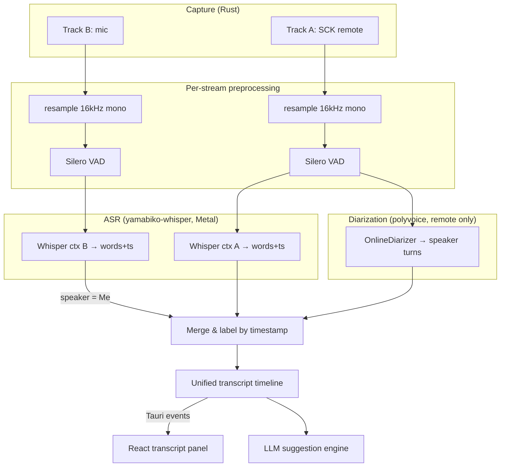

# Real-Time Transcription (Dual-Stream, Local)

How the Tauri app turns the two captured audio streams into a live, speaker-attributed transcript that feeds the LLM suggestion engine.

Prerequisites and capture details:

- [macos-app-architecture.md](./macos-app-architecture.md) — Tauri + Rust + React stack, IPC model
- [macos-capturing-audio.md](./macos-capturing-audio.md) — dual-track capture, echo, clock drift

## Goal & Decisions

Real-time transcription of **two speakers**: the local user (microphone) and the remote participant(s) on a VoIP call (system audio). Confirmed design constraints:

| Decision | Choice |
| --- | --- |
| **Execution** | **Local on-device only.** No audio leaves the machine. `whisper.cpp` via Rust. |
| **Hardware target** | Apple Silicon (M1+), **16 GB+ RAM** as the well-supported baseline. |
| **Language** | **English only.** Decode with `language = "en"` forced (skips detection, faster, no drift). |
| **Latency feel** | **Streaming with live partial hypotheses** (words appear as spoken, then stabilize). |
| **Diarization** | Mic = always "Me". **Remote stream may contain multiple people → needs diarization.** |

## Two Streams, Two Roles

The dual-track capture already solves speaker attribution for the simple case — each stream is one role. The new requirement is multi-speaker resolution *inside* the remote stream.

| Stream | Source | Speakers | Processing |
| --- | --- | --- | --- |
| **Track B — Mic** | CoreAudio local mic | Exactly one ("Me") | ASR only, no diarization |
| **Track A — Remote** | ScreenCaptureKit (VoIP app output) | One or many | ASR **+** online diarization |

This asymmetry is the core of the design: we never waste compute diarizing the mic, and we only run the expensive diarizer on the stream that needs it.

## Engine & Model Selection

### ASR: `whisper.cpp` via Rust with streaming

Recommended crate: **`yamabiko-whisper`** (built on `whisper-rs`/`whisper.cpp`). It implements the **LocalAgreement-2** streaming policy from streaming-Whisper research, which is exactly the "live partial + stabilized commit" behavior requested: it returns *committed words* plus a *tentative live hypothesis*, with built-in Silero VAD, 16 kHz resampling, and channel downmix.

Acceleration is selected by cargo feature (pass-through to `whisper-rs`):

```toml
# Primary: Metal GPU (zero-copy on Apple Silicon, auto CPU fallback inside whisper.cpp)
yamabiko-whisper = { version = "0.2", features = ["metal"] }
```

Alternatives considered:

- **`whisper-cpp-plus`** — `WhisperStreamPcm` + Silero VAD, `metal`/`coreml` features. Good if we want to own the streaming policy ourselves.
- **`whisper-rs`** — the base bindings. Most control, most glue code (we'd build streaming + VAD).

**CoreML/ANE** (`coreml` feature) can be ~3–5× faster on the encoder but requires shipping pre-converted `.mlmodelc` bundles. Treat it as an optional post-v1 "performance pack", not the default — Metal is a drop-in feature flag and already fast enough.

### Model: `large-v3-turbo` default, `small.en` fallback

English-only on 16 GB+ Apple Silicon, running **two concurrent streams** (so ~2× the compute budget):

| Model | GGML size | Speed (Metal) | English WER | Role |
| --- | --- | --- | --- | --- |
| **`large-v3-turbo`** | ~1.5 GB | ~8–10× realtime | ~2.5% | **Default.** Multilingual-only build, excellent on English |
| `medium.en` | ~1.5 GB | ~2× realtime | ~2.9% | Quality alternative if turbo accuracy disappoints |
| `small.en` | ~466 MB | ~6–12× realtime | ~3.4% | **Fallback** for battery, thermal, or CPU-only |
| `base.en` | ~142 MB | ~7–16× realtime | ~5% | Last-resort low-power mode |

Note: there is no `turbo.en` — turbo ships multilingual only, which is fine since we force `language = "en"`.

### Diarization (remote stream only): `polyvoice` online

For multi-speaker resolution on Track A in real time, use **`polyvoice`** — a pure-Rust (ONNX) diarization library with an explicit **`OnlineDiarizer`** for streaming, Silero VAD, overlap-aware powerset segmentation, automatic speaker-count (auto-k) clustering with online incremental centroid updates, and a CoreML feature.

```toml
polyvoice = { version = "0.6", features = ["coreml"] }
```

- **Online path (live):** `OnlineDiarizer` processes the remote stream in a rolling window, emitting provisional speaker turns ("Remote 1", "Remote 2", …) with bounded latency. Incremental clustering means labels get more accurate as the call progresses.
- **Offline refinement (optional, post-call):** **`speakrs`** runs the full pyannote `community-1` pipeline (PLDA + VBx) at ~500× realtime on CoreML for a high-accuracy re-diarization of the saved remote track, correcting any provisional labels for the post-call breakdown.

## Pipeline



### Step by step

1. **Preprocess** each stream independently: downmix to mono, resample to **16 kHz** (Whisper's required rate), normalize.
2. **VAD-gate** with Silero: only forward speech regions. This avoids hallucinated text on silence, cuts GPU work, and provides natural chunk boundaries.
3. **ASR per stream** on dedicated Whisper contexts running on Tokio blocking threads (one per stream so they don't serialize). LocalAgreement-2 emits a tentative hypothesis immediately and commits words once stable across consecutive windows.
4. **Diarize the remote stream** in parallel with `OnlineDiarizer`, producing time-ranged speaker turns.
5. **Merge & label:**
   - Track B words → speaker `Me`.
   - Track A words → assign to the diarization speaker turn with the **maximum temporal overlap**.
   - Combine both into one timeline sorted by start timestamp.
6. **Emit** partial and committed segments to the React UI and append committed text to the rolling LLM context window.

### Speaker labeling

- Mic is hard-coded `Me`.
- Remote speakers start as provisional `Remote 1`, `Remote 2`, … Online clustering may **re-map** a provisional ID as more audio arrives; emit updates so the UI can relabel retroactively.
- Optionally let the user rename a remote speaker in the UI; persist the mapping for the session and post-call breakdown.

## Concurrency & Threading

- Two Whisper contexts (`Send + Sync`, shareable via `Arc`) on separate `tokio::task::spawn_blocking` workers — inference is CPU/GPU-bound and must stay off the async reactor and the UI thread.
- One diarization worker for the remote stream.
- Bounded channels (`tokio::sync::mpsc`) between capture → VAD → ASR/diar → merge, so a slow consumer applies backpressure rather than growing memory unbounded.
- The merge stage is the single owner of the transcript timeline (one writer), emitting deltas over Tauri events.

## Performance Budget (rough, M-series 16 GB)

| Stage | Cost |
| --- | --- |
| 2× `large-v3-turbo` (Metal) | well under realtime each (~8–10× headroom) |
| `polyvoice` online diarization (remote) | small fraction of realtime |
| Silero VAD ×2 | negligible |
| RAM (2 turbo contexts ~2.3 GB each + ONNX) | comfortably within 16 GB |

If thermals/battery degrade or RAM is tight (8 GB machines), the **fallback ladder** is: `large-v3-turbo` → `small.en` → `base.en`, and Metal → CPU. Diarization can be dropped to single-speaker (`Remote`) mode under pressure.

## IPC: Rust → React

Keep payloads small (text + metadata only; raw PCM never crosses IPC). Suggested events:

| Event | Payload |
| --- | --- |
| `transcript.partial` | `{ stream: "remote", speaker?: "Remote 1", text, startTs, endTs }` |
| `transcript.commit` | `{ stream, speaker, words: [{text, startTs, endTs}], segmentId }` |
| `speaker.relabel` | `{ from: "Remote 2", to: "Remote 1" }` (online clustering correction) |
| `asr.status` | `{ model, backend: "metal"\|"cpu", language: "en" }` |
| `vad.activity` | `{ stream, active: bool, levelDb }` (for UI metering) |

Partial segments render in a muted style and are replaced in place by their committed version (the "aperçu" pattern), so the transcript feels live without churn.

## Models on Disk

- Bundle or first-run download GGML weights: `ggml-large-v3-turbo.bin` (default), `ggml-small.en.bin` (fallback).
- Silero VAD ONNX model (ships with the ASR/diar crates or downloaded once).
- `polyvoice` ONNX segmentation + embedding models.
- Verify integrity (checksum/signature) on download; cache under the app support directory.

## Implementation Phases

1. **Single stream, batch** — wire `yamabiko-whisper` + Metal, transcribe the mic to committed text. Prove the model loads and Metal is active.
2. **Streaming partials** — surface LocalAgreement-2 tentative + committed words over Tauri events; render the aperçu in React.
3. **Second stream** — add the remote (SCK) Whisper context; two-worker concurrency; merged timeline with `Me` vs `Remote`.
4. **Online diarization** — add `polyvoice` `OnlineDiarizer` on the remote stream; overlap-based labeling; `speaker.relabel` updates.
5. **Fallback ladder** — model/backend downgrade logic under thermal/RAM/CPU pressure.
6. **LLM integration** — feed the committed, speaker-labeled timeline into the existing suggestion engine.
7. **Post-call refinement (optional)** — re-diarize saved remote track with `speakrs` for the breakdown view.
