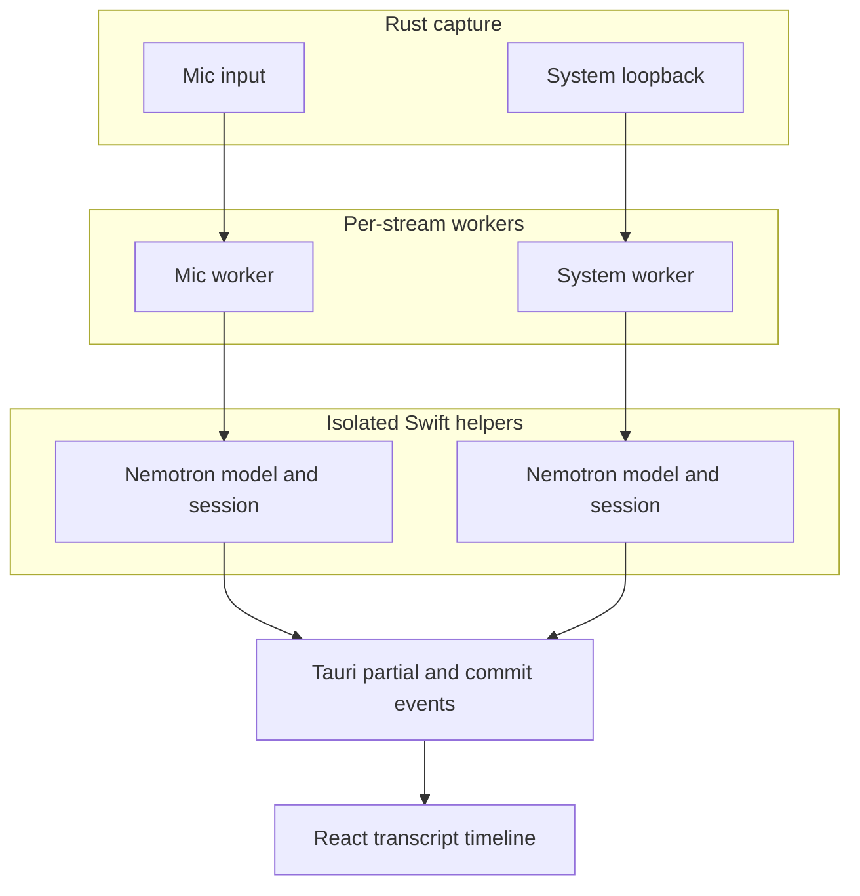

# Real-Time Transcription

The macOS app transcribes microphone and system audio locally with NVIDIA Nemotron 3.5 ASR Streaming 0.6B.

## Decisions

- Execution is local; captured audio never leaves the machine.
- Target hardware is Apple Silicon on macOS 15 or newer.
- Recognition is fixed to the model’s `en-US` prompt.
- The fixed model bundle uses 320 ms streaming chunks.
- Mic and system audio are separate streams with static `User` and `Remote` labels.
- Speaker diarization inside the remote stream is not implemented.

## Data flow

Each active stream owns a helper process and model instance. `speech-swift` declares the model non-thread-safe, so dual-stream mode does not share a model.

## Capture and bridge

Rust capture callbacks downmix to mono Float32 and write bounded channels. A worker forwards audio to its helper as base64 PCM16 over newline-delimited JSON. The helper:

1. Resamples to 16 kHz.
2. Feeds arbitrary packet sizes into the model’s internal 320 ms buffer.
3. Emits the latest cumulative hypothesis as a `partial`.
4. Detects trailing silence using rolling RMS.
5. Calls `finalize()`, emits a `commit`, and creates a fresh model session.

The JSON protocol is:

- Rust to helper: `init`, `audio`, `finish`, `shutdown`
- Helper to Rust: `loading`, `ready`, `partial`, `commit`, `error`, `finished`

## Partial and commit semantics

Nemotron returns the complete hypothesis accumulated in the current model session. It is not an append-only delta. The frontend therefore replaces one stream-scoped tentative segment (`tentative-mic` or `tentative-system`) on every update.

The model has no end-of-utterance head. Boundary settings are runtime-configurable:

- `NEMOTRON_SPEECH_RMS_THRESHOLD` (default `0.01`)
- `NEMOTRON_EOU_SILENCE_MS` (default `800`)
- `NEMOTRON_MIN_SPEECH_MS` (default `300`)

These defaults are starting points and must be tuned using recorded calls.

## Timestamps

The selected runtime exposes no frame/token alignments. The helper maintains a monotonic 16 kHz sample clock:

- partial start: first speech sample in the current utterance
- partial end: latest consumed sample
- commit start/end: utterance sample bounds when finalized

This is sufficient for ordering the two capture streams. Word-level diarization would require a separate alignment implementation.

## Resource and stability behavior

The Nemotron 3.5 CoreML artifact is approximately 612 MB. Dual-stream mode loads two copies plus CoreML working memory. Inference runs inside autorelease pools. Helpers are terminated when their workers stop, so a new app transcription session gets fresh CoreML model processes.

The bounded Rust channels provide backpressure protection. Debug captures record captured/dropped samples, ASR pass timings, and emitted commits.

## Verification

- `cd apps/amie/nemotron-helper && swift test`
- `cd apps/amie/src-tauri && cargo test`
- `cd apps/amie && pnpm test`
- `cd apps/amie/src-tauri && cargo test diagnose_model_vs_commit_strategy -- --ignored --nocapture`
- `cd apps/amie && pnpm test:golden:e2e`

Production acceptance additionally requires a 30-minute dual-stream soak, repeated start/stop testing, latency percentiles, memory measurement, and timestamp drift checks.

The English 160 ms artifact previously measured 18.0% fixed-reference file WER. The production-path Nemotron 3.5 run measured 4.59% file WER and 4.95% clean loopback E2E WER using the repository scorer, passing the 5% gate. See [MODEL_INVESTIGATION.md](../../MODEL_INVESTIGATION.md) for the full comparison.
