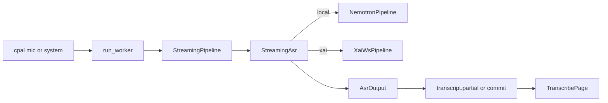

# xAI Speech-to-Text (Dual-Backend Integration)

How the Tauri app adds **xAI real-time STT** alongside the local Nemotron path, so either backend can be selected at session start.

**Branch of record:** `experiement/nvidia-parakeet-model`  
**Upstream API docs:** [xAI Speech to Text](https://docs.x.ai/developers/model-capabilities/audio/speech-to-text)

---

## Goal & locked decisions

| Decision | Choice |
| --- | --- |
| Transport | **WebSocket streaming** (`wss://api.x.ai/v1/stt`), not batch `POST /v1/stt` |
| Model | **`grok-voice-transcribe-2.0`** (explicit `model` query param; API default remains 1.0 if omitted) |
| Dual-stream (`mic` + `system`) | **Two independent WebSocket sessions** (one per stream) — preserves User/Remote labels |
| Selection | UI toggle on New chat + API key on Settings |
| Local path | Unchanged Nemotron behavior; default `AsrBackend::Local` |
| Audio to xAI | PCM16 LE mono @ **16 kHz**, ~**100 ms** binary frames, **realtime-paced** |

---

## Architecture seam

Capture, worker loop, IPC, and React transcript UI stay backend-agnostic. Polymorphism lives at the pipeline boundary.



### Trait (required for dual-backend)

[`apps/tauri-app/src-tauri/src/transcription/pipeline.rs`](../../apps/tauri-app/src-tauri/src/transcription/pipeline.rs):

```rust
pub trait StreamingAsr: Send {
    fn push_mono(&mut self, samples: &[f32]) -> anyhow::Result<Option<AsrOutput>>;
    fn finish(&mut self) -> anyhow::Result<AsrOutput>;
}

pub struct StreamingPipeline {
    inner: Box<dyn StreamingAsr>,
}
```

`AsrOutput` / `AsrWord` are unchanged: `committed` + `tentative` word lists with `start`/`end` seconds.

### Factory

[`LoadedEngine`](../../apps/tauri-app/src-tauri/src/transcription/asr.rs) loads by `AsrBackend`:

- **Local** — validate Nemotron helper + CoreML bundle; `create_pipeline` → `NemotronPipeline`
- **Xai** — resolve API key; skip Nemotron validate; `create_pipeline` → `XaiWsPipeline` (`language=en`, `disable_partials=false`, `model=grok-voice-transcribe-2.0`)

Switching backends mid-process drops the cached engine and reloads.

### Dual-stream

[`TranscriptionService`](../../apps/tauri-app/src-tauri/src/transcription/service.rs) still spawns **two** `StreamPair`s for `AudioSource::Both`. Each pair gets its own `create_pipeline(sample_rate, stream="mic"|"system")`. For xAI that means two sockets and two API streams — intentional.

---

## Files

### New files

| Path | Role |
| --- | --- |
| `apps/tauri-app/src-tauri/src/transcription/xai.rs` | WebSocket client, resample, pacing, event→`AsrOutput`, API key IO |
| `apps/tauri-app/src-tauri/src/transcription/backend.rs` | `AsrBackend { Local, Xai }` + `parse` / `from_env` (`nemotron` / `parakeet` aliases map to Local) |

### Rust

| Path | Change |
| --- | --- |
| `transcription/pipeline.rs` | Add `StreamingAsr`; `StreamingPipeline` wraps `Box<dyn StreamingAsr>` |
| `transcription/nemotron.rs` | `impl StreamingAsr for NemotronPipeline` |
| `transcription/asr.rs` | Backend-aware `LoadedEngine::load` / `create_pipeline` |
| `transcription/service.rs` | `start(..., backend)`; headless uses `AsrBackend::from_env()` |
| `transcription/mod.rs` | Export `xai`, `backend`, `StreamingAsr` |
| `commands/transcription.rs` | `backend` arg; `get_asr_settings` / `set_xai_api_key` / `clear_xai_api_key` |
| `lib.rs` | Register new commands; export `AsrBackend` |
| `Cargo.toml` + `Cargo.lock` | `tokio` features, `tokio-tungstenite`, `futures-util` |
| `bin/file_transcribe.rs` | `LoadedEngine::load(&config, AsrBackend::Local)` |
| `tests/golden_diagnostic.rs` | `ASR_BACKEND=xai` support for file pipeline |
| `tests/golden_transcript.rs` | Skip Nemotron validate when `ASR_BACKEND=xai` |

### Frontend

| Path | Change |
| --- | --- |
| `src/lib/transcript-types.ts` | `AsrBackend`, `AsrSettings` |
| `src/hooks/useTranscription.ts` | `start(source, backend)` → invoke with `backend` |
| `src/pages/TranscribePage.tsx` | ASR select; persist choice in `localStorage` (`asrBackend`) |
| `src/pages/SettingsPage.tsx` | API key save/clear; **masked disabled field when key set** (never show real key) |
| `src/App.css` | `.settings-*` styles |

---

## xAI WebSocket protocol (as implemented)

### Connect

```
wss://api.x.ai/v1/stt?sample_rate=16000&encoding=pcm&interim_results={bool}&language={lang}&endpointing=800&filler_words=false&model=grok-voice-transcribe-2.0
Authorization: Bearer <api_key>
```

- Wait for `transcript.created` before sending audio (`READY_TIMEOUT` = 30s).
- Auth header set on the HTTP upgrade request (`IntoClientRequest` + `Authorization`).

### Client → server

| Message | When |
| --- | --- |
| Binary frame (PCM16 LE) | ~100 ms = 3200 bytes @ 16 kHz, **realtime-paced** |
| `{"type":"audio.done"}` | On `finish()` / stop |

### Server → client → `AsrOutput`

| Event | Mapping |
| --- | --- |
| `transcript.partial` with `is_final=false` | → `tentative` (replace) |
| `transcript.partial` with `is_final=true`, `speech_final=false` | → **tentative only** (chunk-final preview) |
| `transcript.partial` with `is_final=true`, `speech_final=true` | → **one `committed` utterance** (dedupe identical repeats) |
| `transcript.done` | Session end signal only — **do not append full-session text** (already covered by `speech_final`) |
| `error` | Propagate; worker emits `transcription.status` error |

**Critical lesson:** committing both chunk-finals and `speech_final` **duplicates** transcript text and destroys WER. Only `speech_final` creates commits.

### Threading model

`XaiWsPipeline` is sync (matches the worker). Internally:

1. Dedicated OS thread with a current-thread Tokio runtime owns the WebSocket.
2. Sync `mpsc` channels: `Cmd::{Audio,Finish}` in, `Evt::{Ready,Output,Error,Done}` out.
3. Async loop: `select!` between `read.next()` and a 10 ms poll of `cmd_rx.try_recv()` (never block the runtime on sync `recv`).

### Resample + pacing

- Device mono `f32` → linear resample to 16 kHz → PCM16 LE buffer.
- Frames flush every 3200 bytes.
- **Pace sends to ~100 ms/frame.** Dumping faster-than-realtime yields empty / garbage transcripts from xAI.

### API key storage

| Source | Priority |
| --- | --- |
| Env `XAI_API_KEY` | Highest if non-empty |
| File `~/Library/Application Support/com.pavel.tauri-app/xai_api_key` | Fallback |

Settings UI never returns the raw key to the frontend — only booleans (`xaiApiKeySet`, `xaiApiKeySaved`, `xaiApiKeyFromEnv`). When set, the input shows a fake mask and is disabled.

---

## IPC / UI contract

### Commands

| Command | Args | Notes |
| --- | --- | --- |
| `start_transcription` | `source?`, `backend?` | `backend`: `"local"` \| `"xai"` (default local) |
| `stop_transcription` | — | Unchanged |
| `get_asr_settings` | — | `{ backendOptions, xaiApiKeySet, xaiApiKeySaved, xaiApiKeyFromEnv }` |
| `set_xai_api_key` | `{ key }` | Writes app-support file |
| `clear_xai_api_key` | — | Deletes saved file only |

### Status badge

`transcription.status.model` is `"xAI Transcribe 2.0"` or the Nemotron display name — UI already shows opaque model string.

---

## Dependencies

In `apps/tauri-app/src-tauri/Cargo.toml`:

```toml
tokio = { version = "1", features = ["rt-multi-thread", "macros", "sync", "time", "net"] }
tokio-tungstenite = { version = "0.26", features = ["native-tls"] }
futures-util = "0.3"
```

---

## Testing

### Local golden (unchanged)

```bash
cd apps/tauri-app && pnpm test:golden
```

Phase-1 eval vs baseline; headless E2E still defaults to Nemotron unless overridden.

### xAI file-pipeline diagnostic

Requires saved key or `XAI_API_KEY`. Takes ~realtime length of the clip (~80s for `test-youtube-video`).

```bash
cd apps/tauri-app
ASR_BACKEND=xai cargo test diagnose_model_vs_commit_strategy \
  --manifest-path src-tauri/Cargo.toml -- --ignored --nocapture
```

Artifacts: `test-output/diagnostic/file-*-xai.txt`

### Manual UI

1. Settings → save xAI API key (or export `XAI_API_KEY`)
2. New chat → ASR: **xAI Transcribe 2.0** → Start
3. Prefer mic-only first, then **Mic + system** (two sockets)

---

## Pitfalls (do not regress)

1. **Faster-than-realtime audio** → empty transcript. Keep 100 ms pacing.
2. **Committing chunk-finals + speech_final** → duplicated prose / inflated WER.
3. **Appending `transcript.done` full text** → second full-session duplicate on stop.
4. **Blocking sync `recv` inside Tokio** → deadlock the WS reader; use `try_recv` + short sleep.
5. **Exposing API key to the webview** → store only in Rust/app-support; UI gets booleans + mask.
6. **Both mode** = two billable/concurrent xAI sessions; that is by design for label fidelity.

---

## Out of scope

- Opus encoding, Smart Turn tuning, multichannel single-socket mode
- HTTP proxy / server-side key vault
- Golden E2E WER gates for xAI (local baseline remains Nemotron)
- Changing NOTSOFAR batch eval (`eval_notsofar.py` already uses HTTP `POST /v1/stt`)
